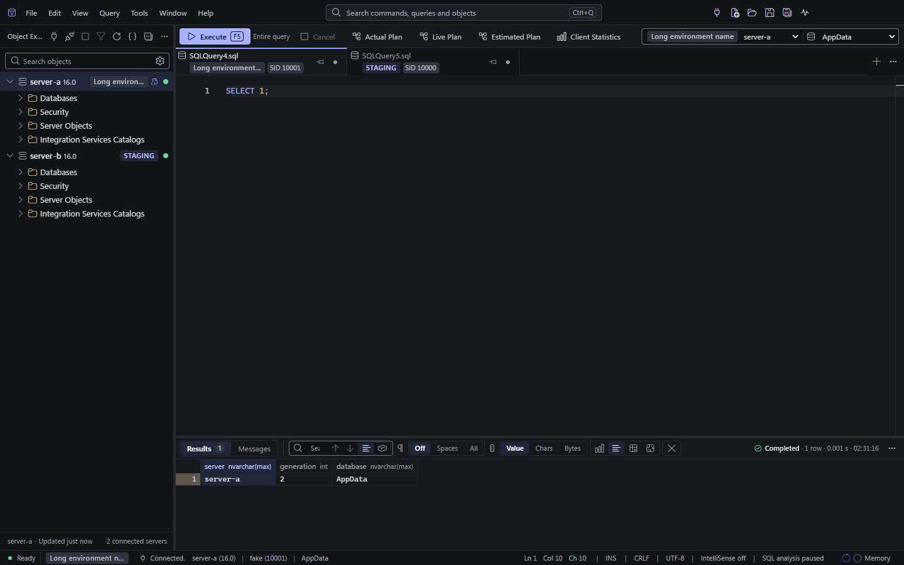

# Varia SQL Manager

A fast, cross-platform desktop workbench for Microsoft SQL Server: a T-SQL editor, query results, execution plans and
database management tools in one app, with SSMS's features and keys and a modern look.

[](https://github.com/CDoughty08/varia-sql-manager/actions/workflows/ci.yml)
[](https://github.com/CDoughty08/varia-sql-manager/releases)



> Varia is under active development. See the [changelog](CHANGELOG.md) for what is new.

## Highlights

- **Query editor**: Monaco-based T-SQL editor with IntelliSense, Go To Definition (F12) and Peek (Ctrl+hover, Alt+F12), `GO`
  batches, and a separate session per query tab.
- **Results**: in-memory sort, filter, search, highlight, transpose, pivot, column profiles and result comparison, with
  no re-query. Results show as tabs or stacked, can be [named](docs/named-result-sets-scope.md) from the query text, and
  export to CSV, tab-delimited text or JSON.
- **Execution plans**: estimated, actual and live plans on a GPU canvas, plan history and side-by-side comparison, plus
  Client Statistics.
- **Object Explorer**: browse servers and databases, Search Objects, View Dependencies, Script As, Table Designer,
  object properties and actions, Restore Database.
- **Monitoring**: Activity Monitor (sessions, blocking, expensive queries, waits, file I/O) and the Integration Services
  Catalog, with live data that refreshes on its own.
- **Workbench**: VS Code-style command palette (F1), editor groups, popout windows, hot exit that restores tabs and
  connections, a main window that reopens where you left it (safely back on screen if a monitor is gone), remappable keyboard shortcuts and mouse gestures, Dark, Light or System themes, customizable.
- **Authentication**: SQL Server, Windows (Kerberos on Linux and macOS) and Microsoft Entra ID.

Varia supports SQL Server 2016 through 2025 and runs on Windows, Linux and macOS.

## Install

Download a build from [GitHub Releases](https://github.com/CDoughty08/varia-sql-manager/releases). Builds include the
.NET backend; no SDK is needed.

| Platform | Packages |
| --- | --- |
| Windows x64 | Setup (per-user or all users; `--silent` for unattended installs) or Portable `.exe` |
| Linux x64 | AppImage (needs FUSE, and a keyring to remember passwords) |
| macOS (Apple Silicon, Intel) | DMG or ZIP |

Builds are not yet code-signed, and macOS builds are not notarized, so your OS may warn before opening them. Varia
checks GitHub for updates and installs them on restart (macOS opens the release page instead); see
[updates](docs/updates.md) for proxy requirements and how to turn this off.

## Quick start

1. Click **Connect**, enter a server, and pick an authentication method.
2. Open a new query (**Ctrl+N**), write T-SQL and press **F5**. If text is selected, only the selection runs.
3. Explore results and messages below the editor, or browse and script objects in Object Explorer.

Press **F1** for the command palette, and see **Help › Getting Started** for offline guides. The
[command reference](docs/commands.md) lists every command and shortcut.

Certificate validation is on by default; enable **Trust server certificate** only for a trusted server with a
self-signed certificate. Windows authentication on Linux and macOS needs the system Kerberos library, a ticket from
`kinit` and a server name or SPN registered for Kerberos; Entra Integrated authentication is Windows-only. Remembered passwords are encrypted with the OS credential store.

## Not yet available

SQLCMD mode, Results to Text and Results to File (grid results can be exported), IntelliSense for Entra connections,
backup, SQL Server Agent job management, and database user and role dialogs (logins are supported).

## Build from source

Prerequisites: Node.js 24+ and the .NET 11 SDK (version pinned in `global.json`).

```sh
npm ci
npm run dev        # build the backend and start Electron with hot reload
```

```sh
npm run build && npm start   # production build, no dev server
```

On Ubuntu 24.04+, AppArmor may block the user namespaces Electron's sandbox needs; allow them if Electron will not start.

## Development

```sh
npm run check          # typecheck, .NET checks, vitest and production build
npm run test:smoke     # Electron smoke suites (after check)
npm run bench          # IPC benchmarks (after check)
```

The default checks need no database. Live SQL checks run when `VARIA_TEST_SQL_SERVER` is set; use a disposable
server. [docs/testing.md](docs/testing.md) lists the test variables, and [CLAUDE.md](CLAUDE.md) has the contributor and
architecture rules.

electron-vite bundles every npm package, so all of them are listed under devDependencies, but those devDependencies ship
in the app (zod, React, Monaco with DOMPurify, Dockview, PixiJS): audit without `--omit=dev` and treat their advisories
as production ones.

Releases are cut by pushing a `v<version>` tag after updating `package.json` and `package-lock.json` and adding the
release record; see [cutting a release](docs/release-notes.md#cutting-a-release).

## Architecture

An Electron + React + Monaco + Dockview front end talks to a .NET sidecar (Microsoft.Data.SqlClient and SMO) over a
length-prefixed MessagePack protocol on stdio. The renderer is sandboxed and untrusted; it reaches the system only
through a small preload API that main verifies, and query results stay in backend memory under a budget with explicit truncation, never on disk.

- [Architecture invariants](docs/architecture.md)
- [IPC protocol](docs/ipc.md)
- [CI](docs/ci.md) and [testing](docs/testing.md)

## Documentation

| Area | Docs |
| --- | --- |
| Editor | [Language services](docs/language-services.md), [commands](docs/commands.md), [gestures](docs/gestures.md), [editor groups](docs/editor-groups.md), [hot exit](docs/hot-exit.md), [popout windows](docs/popout-windows.md) |
| Results | [Result grid tools](docs/results-tools.md), [named results](docs/named-result-sets-scope.md), [execution plans](docs/execution-plans.md) |
| Objects | [Object Explorer](docs/object-explorer.md), [connections](docs/connections-explorer.md), [object actions](docs/object-actions.md), [Search Objects](docs/object-search.md), [scripting](docs/scripting.md), [Table Designer](docs/table-designer.md) |
| Monitoring | [Activity Monitor](docs/activity-monitor.md), [live data](docs/live.md), [Integration Services](docs/integration-services.md) |
| App | [Settings](docs/settings.md), [themes](docs/themes/README.md), [updates](docs/updates.md), [About](docs/about.md), [Getting Started](docs/getting-started.md), [release notes](docs/release-notes.md) |

No license has been chosen yet.
