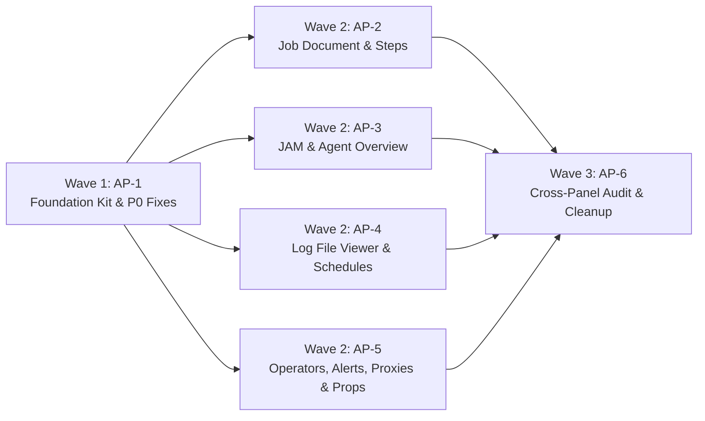

# SQL Server Agent UX & visual polish plan

Status: **agreed with the owner on 2026-11-26** (all Option A recommendations + balanced column-aligned step cards + persisted resizable sashes across all left/right rails). Interactive design lab: [docs/mockups/sql-server-agent-polish.html](mockups/sql-server-agent-polish.html) (open directly in a browser; Dark/Light, Compact/Comfortable, 8 Agent panels, live draggable sashes, and 1-click toggles for **Option A (Agreed)**, **Option B**, and **Today (Baseline)**).

Each PR updates its area's doc, `CHANGELOG.md`'s Unreleased summary, marks its row **Done** here, passes a full adversarial review cycle (0 Critical/High/Medium, all Low findings fixed), and produces a live Electron screenshot pack for owner validation. Once all lanes ship, fold any standing rules into [docs/sql-server-agent.md](sql-server-agent.md) and delete this plan.

---

## Goals and non-goals

Goals:

- Fix the live P0 CSS/layout defects found in the Agent UX inventory:
  - `.agent-history` / `.agent-history-body` / `.agent-history-message` CSS collision between `LogFileViewer.tsx` and `JobHistory.tsx` (`styles.css` `.lfv-*` vs `.agent-job-history-*`).
  - Unstyled `.properties-table` placed directly on `<table>` across 8 Agent components.
  - `OperatorsDocument.tsx` 3rd flex-column bug where `<JobsTable />` renders horizontally beside `<SidePane />`.
  - Missing `DocumentFrame` header/breadcrumbs on `SchedulesDocument.tsx`.
- Align all SQL Server Agent documents with Varia's recent Calm Pro polish (`ObjectInspectorFrame` from Table Properties, `PropertyField` / `Switch` / `FactGrid` / `RatioBar` from Properties & Options, and WP-1–WP-6 resting chrome, typography, and progressive disclosure):
  - **Zero scroll areas inside scroll areas:** explicit `flow` vs `fill` panes on `ObjectInspectorFrame`.
  - **Tight alignment, zero saw-toothing:** unified `160 px` label column across all Agent forms and balanced 3-column Step Cards (`44 px` fixed mono type badge + equal `1fr` `✓` and `✗` columns).
  - **Persisted resizable rails:** every left/right split pane uses a shared draggable vertical sash with functional min/max clamping, keyboard support, double-click reset, and persisted width.
  - **Consistent typography & emphasis:** `11 px` uppercase muted group eyebrows, monospace `tabular-nums` on all timestamps/durations/counts/step numbers/codes/paths, and Calm Pro tables.
- Preserve every SSMS capability, command ID, keyboard shortcut, ARIA role/name contract (`scripts/fixtures/ui.mjs`), STALE guard, hot-exit draft behavior, and secret-slot guarantee. Zero C# backend or IPC protocol changes.

Non-goals:

- New backend SQL/RPC methods or msdb write semantics (no C# changes).
- Redesigning the Flow graph view (Flow view already shipped on `main` via `JobStepsFlow.tsx`, `FlowRunPanel.tsx`, and `FlowCanvas.ts`; preserve as-is).
- Promoting SQL Server Agent Properties from modal dialog to a document tab (stays a modernized Calm Pro modal in this wave).
- Retroactively migrating existing non-Agent splitters (`OptionsDialog`, `ObjectInspectorFrame`'s Vitals sash, `PlanPaneSizer`) onto `ResizableSplit` during this wave — `ResizableSplit` will expose both self-persisted (`storageKey`) and controlled (`width` / `onWidthChange` / `onWidthReset`) modes so those surfaces can consolidate cleanly in a separate follow-up PR without widening smoke-test blast radius here.

---

## Owner decisions (2026-11-26)

1. **All Option A recommendations** across the 8 Agent surfaces in [docs/mockups/sql-server-agent-polish.html](mockups/sql-server-agent-polish.html).
2. **Balanced column-aligned Step Cards:** fixed-width centered mono type pill (`TSQL`, `SSIS`, `PS`, `Cmd` — full subsystem name in tooltip) followed by two equal `minmax(0, 1fr)` single-line columns for `✓` On success and `✗` On failure so green/red indicators align vertically across every step with zero snaggle-tooth or 2-line wrapping.
3. **Persisted resizable sashes on all left/right rails:** no fixed-width rails; every left/right split uses a draggable separator with functional min/max widths, dynamic clamping so the opposite pane never crushes, keyboard resize (`ArrowLeft`/`ArrowRight`/`Shift`/`Home`), double-click reset, and persisted widths (matching `ObjectInspectorFrame` Vitals and `OptionsDialog` rail behavior).

---

## Shared rail width contract

All Agent left/right splits (except `ObjectInspectorFrame`'s Vitals rail, which already persists through `workbench.inspector.vitals` in `src/main/inspector-vitals-store.ts`) use the new `ResizableSplit` kit (`src/renderer/src/kit/ResizableSplit.tsx` + `src/renderer/src/kit/resizable-split.ts`) built on `followPointerDrag` and `observeResize`, persisting per-rail widths to `localStorage` under `varia.split.<id>` (matching `options-form.ts`'s `varia.options.railWidth` pattern):

| Split ID | Surface | Side | Default | Min | Max | Min opposite pane |
| --- | --- | --- | --- | --- | --- | --- |
| *(existing `vitals.full`)* | Job Document Vitals rail | Right | 272 px | 200 px | 440 px | 48% share cap |
| `agent.job.steps` | Job › Steps list rail | Left | 304 px | 252 px | 480 px | 360 px |
| `agent.job.schedules` | Job › Schedules list rail | Left | 284 px | 236 px | 460 px | 360 px |
| `agent.job.history` | Job › History runs list | Left | 276 px | 232 px | 440 px | 380 px |
| `agent.jam.lastRunMessage` | JAM › Last Run message preview | Right | 440 px | 260 px | 720 px | 320 px |
| `agent.lfv.sources` | Log File Viewer › Select logs rail | Left | 236 px | 188 px | 380 px | 460 px |
| `agent.lfv.message` | Log File Viewer › Message details | Right | 430 px | 260 px | 720 px | 300 px |
| `agent.schedules.detail` | Schedules › Detail inspector | Right | 472 px | 360 px | 660 px | 340 px |
| `agent.operators.side` | Operators Matrix › Selected operator | Right | 264 px | 220 px | 400 px | 380 px |

---

## `/teamwork` Wave Layout & PR Lanes

Designed for `/teamwork` with a single foundation PR in Wave 1 followed by **4 parallel, file-disjoint PRs** in Wave 2 (each worker uses `workspace: "share"` on its own branch) and a final cross-surface verification/cleanup PR in Wave 3.

| Lane | Wave | Scope | Owned files (disjoint in Wave 2) | Size | Status |
| --- | --- | --- | --- | --- | --- |
| **AP-1** | 1 | `ResizableSplit` kit + persistence, P0 `.agent-history` CSS namespace split, Calm Pro `.agent-table` primitive, P0 `OperatorsDocument` flex-row fix, shared eyebrow/mono/status-bar polish, button-icon alignment, screenshot capture helper | `src/renderer/src/kit/resizable-split.ts`, `ResizableSplit.tsx`, `styles.css` (primitives + anchors), `core/workbench.ts`, `agent/{LogFileViewer,JobHistory,FlowRunPanel,AlertDocument,JobCopyChanges,JobDocument,JobSteps,OperatorDocument,OperatorsDocument,ProxyDocument}.tsx`, `shared/theme/metrics.ts`, `scripts/capture-agent-polish.mjs`, `tests/fixtures/backend.mjs`, `tests/resizable-split.test.ts`, `tests/button-icon-alignment.test.ts` | M | Done |
| **AP-2** | 2 | Job Document on `ObjectInspectorFrame` (`flow`/`fill` tabs + Hero KPIs + Vitals rail), balanced 3-column Step Cards, persisted sashes on Steps/Schedules/History, full-height Monaco & History inspector, `JobCopyChanges` & `CreateSeveral` polish | `src/renderer/src/agent/JobDocument.tsx`, `JobDocumentService.ts`, `JobSteps.tsx`, `JobSchedules.tsx`, `JobHistory.tsx`, `JobCopyChanges.tsx`, `CreateSeveral.tsx`, `tests/agent-job-*.test.ts`, `scripts/agent-job-smoke.mjs` | L | Planned |
| **AP-3** | 2 | Job Activity Monitor (slim 52 px clickable KPI tiles replacing duplicate View chips, grouped toolbar + `More actions ▾`, split Last Run drawer with inline message preview & persisted sash) + Agent Overview (hoisted header status/`Properties` + `FactLine`, clickable KPIs, grouped health checks with fixed action column & object chips) | `src/renderer/src/agent/JobActivityMonitor.tsx`, `JobBulkForms.tsx`, `AgentOverview.tsx`, `tests/agent-job-activity.test.ts`, `tests/agent-job-bulk.test.ts`, `tests/agent-overview.test.ts`, `scripts/agent-jobs-smoke.mjs` | M | Planned |
| **AP-4** | 2 | Log File Viewer (collapsible persisted `Select logs` rail with search & counts, single-row filters, full-height Runs grid, persisted Steps ↔ Message sash, clean Error Log layout) + Schedules & Timeline (`DocumentFrame` header with `Grid \| Timeline`, `Switch` in grid + mono `Next Run`, persisted Detail sash, 2-card preview, collapsible Timeline overlap drawer) | `src/renderer/src/agent/LogFileViewer.tsx`, `SchedulesDocument.tsx`, `ScheduleEditor.tsx`, `SchedulesTimeline.tsx`, `tests/agent-history.test.ts`, `tests/agent-error-logs.test.ts`, `tests/agent-schedules*.test.ts`, `tests/agent-timeline*.test.ts` | M | Done |
| **AP-5** | 2 | Operators & Notifications (`ObjectInspectorFrame` 2-tab Matrix / Jobs, pill cells, persisted Selected Operator sash), Alert / Operator / Proxy / Credential docs (compact `ObjectInspectorFrame` tabs, unified 160 px rail, `Switch`, `FactGrid`), SQL Server Agent Properties modal (Calm Pro `RatioBar`, `Switch`, styled retention table, 26 px controls) | `src/renderer/src/agent/OperatorsDocument.tsx`, `AlertDocument.tsx`, `OperatorDocument.tsx`, `ProxyDocument.tsx`, `CredentialDocument.tsx`, `src/renderer/src/dialogs/pages/AgentPropertiesPages.tsx`, `AgentPages.tsx`, `tests/agent-alerts-operators.test.ts`, `tests/agent-proxy-document.test.ts`, `tests/agent-properties*.test.ts`, `scripts/agent-proxy-smoke.mjs` | M | Planned |
| **AP-6** | 3 | Cross-panel integration verification (no CSS cascade leaks across merged lanes), full `npm run check` + `npm run test:smoke` + `npm run test:smoke:wsl`, viewport & persisted-sash regression sweep, fold standing rules into `docs/sql-server-agent.md`, update `CHANGELOG.md`, remove `docs/agent-polish-plan.md` | `docs/sql-server-agent.md`, `CHANGELOG.md`, `docs/agent-polish-plan.md` (delete), `scripts/fixtures/ui.mjs` (final selector sweep) | S | Planned |

> **Merge hygiene for Wave 2:** `styles.css` is the only shared file touched by AP-2–AP-5. In AP-1, reserve four clearly delimited comment-anchored sections at the bottom of the Agent stylesheet (`/* === AP-2: Job Document === */`, `/* === AP-3: JAM & Overview === */`, `/* === AP-4: LFV & Schedules === */`, `/* === AP-5: Operators, Alerts, Proxies & Props === */`) so Wave 2 workers edit strictly inside their own section with zero merge conflicts.

---

## Detailed Lane Design

### AP-1 — Foundation Kit, P0 CSS/Layout Fixes & Screenshot Harness (`M`)

- **`ResizableSplit` kit (`src/renderer/src/kit/resizable-split.ts`, `ResizableSplit.tsx`):**
  - Supports `side: 'left' | 'right'`, `defaultWidth`, `minWidth`, `maxWidth`, `minOtherWidth`, optional `narrowStackWidth`, and **both** self-persisted (`storageKey` in `localStorage`) and controlled (`width`, `onWidthChange`, `onWidthReset`) modes so existing main-store-backed rails (`ObjectInspectorFrame` Vitals, `PlanPaneSizer`, `OptionsDialog`) can adopt it in a follow-up consolidation PR.
  - Uses `followPointerDrag` + `observeResize`, renders an accessible vertical `role="separator"` (`aria-orientation="vertical"`, `aria-valuemin/max/valuenow`, `tabIndex={0}`), supports `ArrowLeft`/`ArrowRight` (±12 px, `Shift` ±24 px), `Home` and double-click reset to `defaultWidth`, persists widths to `localStorage` safely (ignoring unavailable/corrupt storage), and uses Calm Pro `.varia-sash` styling (1 px resting hairline, 2 px accent highlight on hover/focus/drag, `forced-colors: active` safe).
- **P0 CSS collision fix:** Rename Log File Viewer classes to `.lfv-*` and Job History classes to `.agent-job-history-*` so neither surface overwrites the other's flex/grid layout, padding, or monospace rules.
- **Calm Pro `.agent-table` primitive:** Replace raw `.properties-table` usage on `<table>` elements with `.agent-table` (1 px hairline outer border or `.borderless` for full-bleed panes, sticky `11 px` semibold muted header, `--varia-row` row height, right-aligned mono `.num` columns, calm hover/selection fills, `forced-colors: active` borders).
- **P0 `OperatorsDocument` flex-row repair:** Move `<JobsTable />` out of the horizontal flex container so it no longer renders as a squished 3rd column beside `<SidePane />`.
- **Shared Agent typography & status bar polish:** Add `.agent-eyebrow` (`--varia-size-xs`, 600, uppercase, `0.04em` tracking, muted) and `.agent-mono` (`tabular-nums`), and align `AgentJobStatus` buttons with WP-6 status bar controls.
- **Live screenshot capture harness (`scripts/capture-agent-polish.mjs`):** Reusable Playwright-over-Electron capture utility launching the built app against the fake Agent backend, switching themes (Dark & Light) and viewports (`1440×900` and `1080×720`), and saving deterministic PNGs to an output directory (`--lane ap-1..ap-5 --out <dir>`) for owner validation.

**Checks:** `tests/resizable-split.test.ts` (clamping, dynamic narrow container clamping, pointer drag, keyboard arrows/`Home`, double-click reset, `localStorage` persistence & corrupt-value recovery), `tests/theme-contrast.test.ts`, `tests/theme-metrics.test.ts`, `tests/smoke-selectors.test.ts`, `agent-jobs-smoke`, `agent-job-smoke`.

---

### AP-2 — Job Document on `ObjectInspectorFrame`, Column-Aligned Step Cards & Zero Scroll-in-Scroll (`L`)

- **Migrate `JobDocument` to `ObjectInspectorFrame`:**
  - Header: breadcrumbs (`server › SQL Server Agent › Jobs`), job title, live `StatusPill`, Start split-button / Stop danger button, `Vitals` toggle, `Reload`, `Save · N changes`.
  - Hero KPI strip (`Last Run`, `Duration vs Usual`, `Next Run`, `Owner`).
  - Horizontal `Ctrl+1..N` Inspector Tabs: `[Changes from source]` (when copying) · `General` · `Steps (N)` · `Schedules (N)` · `Notifications & Alerts (N)` (keeping Alerts reachable/labelled cleanly, or separate `Notifications` and `Alerts` tabs if needed for smoke/command parity — verify `revealSection` targets!) · `Targets` (folded into `General` or kept as compact fact block so zero dead tab) · `History (N)`.
  - Collapsible right `Vitals` rail (reusing `ObjectInspectorFrame`'s persisted `workbench.inspector.vitals` rail) showing Live Status, Identity, Start Step, Created/Modified, and active Problems list.
  - Keep `FieldHints` + `FieldHintStrip` overlay + `ScriptDrawer` + STALE compare banner + `StartPanel` (New Job) + `CreateSeveral` intact.
- **Balanced 3-column Step Cards (`JobSteps.tsx`):**
  - `.agent-step-flow` uses `grid-template-columns: 44px minmax(0, 1fr) minmax(0, 1fr)` with a fixed-width centered mono type pill (`TSQL`, `SSIS`, `PS`, `Cmd`, `SSAS`, `Repl` — full subsystem name in `title`) and single-line ellipsized `✓` and `✗` columns (full SSMS target text in `title` and accessible name).
  - Wrap Steps list + Step editor in `ResizableSplit` (`agent.job.steps`, default 304 px, min 252 px, max 480 px) inside a `layout: 'fill'` tab so Monaco grows to fill 100% of remaining vertical space with zero nested outer scroll.
  - Align step editor metadata fields onto the unified `160 px` label column; put `On success` / `On failure` in a crisp 2-column footer row above the collapsible `More options` summary bar.
- **`Schedules` & `History` tabs (`layout: 'fill'`):**
  - `JobSchedules`: `ResizableSplit` (`agent.job.schedules`, default 284 px, min 236 px) separating Attached/Search list from the schedule editor.
  - `JobHistory`: Compact top bar (Sparkline + usual baseline + `All | Failed` switch + Log File Viewer link + live Running bar when active) over `ResizableSplit` (`agent.job.history`, default 276 px, min 232 px) separating Runs list from the full-height Run Detail (styled `.agent-table` Steps + full-height Message inspector with Copy, Edit step, Start at step, SSIS execution link).
- **`General`, `Notifications`, `JobCopyChanges`, `CreateSeveral`:**
  - `Notifications`: clean 2-track `[Level | Operator]` grid aligned to the same right edge; `Switch` for `Enable when saved` in `JobCopyChanges`; `CreateSeveral` uses full-height `fill` layout with zero `max-height: 50vh` trap.

**Checks:** `tests/agent-job-document.test.ts`, `tests/agent-job-steps.test.ts`, `tests/agent-job-history.test.ts`, `tests/agent-create-from.test.ts`, `tests/agent-create-several.test.ts`, `tests/agent-hot-exit.test.ts`, `agent-job-smoke`, `agent-hot-exit-smoke`, plus geometry assertion verifying step-card `✓` and `✗` column X-offsets match across `TSQL`/`SSIS`/`PowerShell` rows.

---

### AP-3 — Job Activity Monitor & Agent Overview Polish (`M`)

- **Job Activity Monitor (`JobActivityMonitor.tsx`, `JobBulkForms.tsx`):**
  - Slim `52 px` clickable KPI tiles (`Running`, `Last run failed`, `Between retries`, `Disabled`) act as the primary view filter; retire the duplicate View chip strip directly underneath (+38 px vertical grid space) while keeping clear-filter and ARIA filter semantics intact.
  - Single grouped toolbar row below tiles: Filter search box + hairline divider + selection count + primary verbs (`Start`, `Stop`, `Enable / Disable ▾`, `More actions ▾` for `Change owner…`, `Attach schedule…`, `View history`, `Create Job Like This…`) + right-pinned `Last run` drawer toggle.
  - Upgrade Last Run bottom drawer into a split pane using `ResizableSplit` (`agent.jam.lastRunMessage`, default 440 px, min 260 px) showing the run's Steps grid beside an inline message preview for the selected/failed step with `Copy`, `Open Job`, and `Log File Viewer` shortcuts.
  - Polish inline `Change owner` and `Attach schedule` bulk forms onto unified `160 px` `PropertyField` rows and Calm Pro borders.
- **Agent Overview (`AgentOverview.tsx`):**
  - Hoist service state `StatusPill` (`Running · Automatic`) and `Properties` button into `DocumentHeader`, and move Service Account, SQL Server Version, and last-checked timestamp into a compact `FactLine` directly under the header (removing the redundant `.agent-overview-head` row).
  - Make KPI tiles interactive (clicking `Failed (24 h)` or `Running` opens JAM pre-filtered to that state).
  - Group Health Checks into **Needs attention** (errors & warnings) and **Passing** (compact rows), with a fixed right action column (`156 px`) so fix buttons never saw-tooth, and render linked jobs/schedules as Calm Pro clickable object chips.

**Checks:** `tests/agent-job-activity.test.ts`, `tests/agent-job-bulk.test.ts`, `tests/agent-overview.test.ts`, `agent-jobs-smoke`.

---

### AP-4 — Log File Viewer & Schedules + Timeline Polish (`M`)

- **Log File Viewer (`LogFileViewer.tsx`):**
  - Clean `DocumentHeader` with `Sources` rail toggle, `Refresh`, `Delete History…`, `Recycle…`, and `LivePill`.
  - Collapsible left `Select logs` rail inside `ResizableSplit` (`agent.lfv.sources`, default 236 px, min 188 px) with an inline search filter for large job lists, grouped `Jobs` / `SQL Server Agent Error Logs` eyebrows with checked counts, and a compact retention footer.
  - Single-row filter bar (`Window` segmented control, `Outcome` select, `Message contains` search, `Step #` mono input, `Clear`).
  - Full-height Runs grid (and clean Error Log pane when checked) above a bottom inspector using `ResizableSplit` (`agent.lfv.message`, default 430 px, min 260 px) between Run Steps and Message Details with mono timestamp header and Copy feedback.
- **Schedules & Timeline (`SchedulesDocument.tsx`, `ScheduleEditor.tsx`, `SchedulesTimeline.tsx`):**
  - Wrap `SchedulesDocument` in `DocumentFrame` (breadcrumbs `server › SQL Server Agent`, title `Schedules`, count pill, `Grid | Timeline` segmented switch in header `tools`, `Refresh` and primary `New schedule` in `verbs`).
  - Secondary compact filter/action bar (`Filter schedules or jobs…`, `All | Unused | Disabled`, `Duplicate`, `Delete`, server-time note).
  - Styled `.agent-table` Schedules grid with inline `Switch` toggles for Enabled, right-aligned tabular `Jobs` count, and a new mono `Next Run` column.
  - Persisted `ResizableSplit` (`agent.schedules.detail`, default 472 px, min 360 px) for the Schedule Detail inspector; restyle `ScheduleEditor` with a tinted summary sentence bar, crisp aligned form rows, and side-by-side `Next 5 runs` + `Jobs using it` cards.
  - Polish `SchedulesTimeline` with clean time gridlines, crisp row headers, and a compact collapsible overlap warning drawer so many overlaps never crush the Gantt viewport.

**Checks:** `tests/agent-history.test.ts`, `tests/agent-error-logs.test.ts`, `tests/agent-schedules.test.ts`, `tests/agent-schedules-render.test.ts`, `tests/agent-timeline.test.ts`, `tests/agent-timeline-view.test.ts`, `tests/agent-timeline-render.test.ts`, plus smoke coverage in `agent-job-smoke`.

---

### AP-5 — Operators & Alerts, Proxies & Credentials, and Agent Properties (`M`)

- **Operators & Notifications (`OperatorsDocument.tsx`):**
  - Migrate to `ObjectInspectorFrame` with 2 `fill` tabs: `Alerts Matrix (N)` and `Jobs Notifying Operators (N)`.
  - Full-height matrix (removing `max-height: 60vh` scroll-in-scroll), pill-styled `E`/`EP`/`P`/`·` buttons, selected-column tinted wash, amber dirty border, and persisted `ResizableSplit` (`agent.operators.side`, default 264 px, min 220 px) for the Selected Operator inspector using `FactGrid`.
- **Alert, Operator, Proxy & Credential Documents (`AlertDocument.tsx`, `OperatorDocument.tsx`, `ProxyDocument.tsx`, `CredentialDocument.tsx`):**
  - Migrate to `ObjectInspectorFrame` (retiring the 176 px left `SectionNav` rail on these 2–4 section documents).
  - Unify onto `160 px` `PropertyField` rows, `Switch` toggles (including Credential's "Change identity and password"), `FactGrid` for lifecycle timestamps (mono `tabular-nums`), styled `.agent-table` tables, and Calm Pro operator/principal chips + subsystem grid card.
  - Preserve `SecretSlot` uncontrolled password handling and script `<secret>` redaction 100%.
- **SQL Server Agent Properties Modal (`AgentPropertiesPages.tsx`, `AgentPages.tsx`):**
  - Replace heavy `<fieldset>` boxes and hardcoded `28 px` inputs with Calm Pro `.agent-eyebrow` headings, `--varia-control` (26 px) controls, `Switch` toggles, `FactGrid` for Agent service & error log metadata, a `RatioBar` showing current job-history log utilization, and a styled `.agent-table` for `What this keeps` with right-aligned mono rates and semantic warning/success kept durations.

**Checks:** `tests/agent-alerts-operators.test.ts`, `tests/agent-proxy-document.test.ts`, `tests/agent-properties.test.ts`, `tests/agent-properties-pages.test.ts`, `agent-proxy-smoke`.

---

### AP-6 — Cross-Panel Audit, WSL Parity & Plan Retirement (`S`)

- Run full `npm run check`, `npm run test:smoke`, and `npm run test:smoke:wsl -- agent-jobs agent-job agent-proxy agent-hot-exit theme`.
- Run a cross-panel automated DOM check verifying: zero unexpected nested vertical scrollers, every persisted sash restores width across remounts, and zero CSS cascade collisions across merged AP-2–AP-5 sections.
- Fold standing UI rules into [docs/sql-server-agent.md](sql-server-agent.md), update `CHANGELOG.md` Unreleased summary, record Getting Started guide/sample impact, and delete `docs/agent-polish-plan.md`.

---

## Mandatory Per-PR Quality Gates

Every PR (AP-1 through AP-6) must satisfy **both** gates before merge:

### 1. Full Adversarial Review Cycle (0 Issues Above Low)

In `/teamwork`, assign a dedicated reviewer worker (never the implementer of that PR) to perform a structured adversarial review and repeat fix → re-review until **0 Critical, 0 High, and 0 Medium** issues remain, **and all Low issues found in the pass are resolved**:

- **Layout & Scroll Discipline:** Verify zero scroll-within-a-scroll containers at `1440×900` and `1080×720`, zero saw-tooth label/button/step-card alignment, and proper dynamic sash clamping when shrinking the window or toggling Vitals/Sources rails.
- **Accessibility & Keyboard:** Verify `scripts/fixtures/ui.mjs` ARIA roles/names, `role="separator"` keyboard resizing (`ArrowLeft`/`ArrowRight`/`Shift`/`Home`) + double-click reset, `Ctrl+1..9` tab focus retention, `forced-colors: active` visibility, and focus rescue when drawers/rails close.
- **Theme, Contrast & Metrics:** Verify `tests/theme-contrast.test.ts`, `tests/theme-metrics.test.ts` (zero literal `px` font sizes, `densityUse` entries up to date), `tests/smoke-selectors.test.ts`, and Dark + Light visual parity.
- **Correctness & Safety:** Verify dirty-state tracking, STALE compare, hot-exit restoration, `SecretSlot` redaction (AP-5), zero polling timers, and no unintended changes outside the lane's owned files.

### 2. Live Screenshot Validation Pack per PR

Each PR must run `scripts/capture-agent-polish.mjs --lane <lane>` against the built Electron app (Dark + Light, `1440×900` and `1080×720`) and present the live screenshots to the owner for visual sign-off before merge:

| PR | Required Live Screenshots (Dark & Light) |
| --- | --- |
| **AP-1** | Before/after of Log File Viewer layout fix, before/after of `.agent-table` styling, `OperatorsDocument` flex fix, and `ResizableSplit` hover/drag state. |
| **AP-2** | Job Document `General` (with Vitals rail), `Steps` (showing aligned 3-column `TSQL`/`SSIS`/`PS` step cards + resized rail), `Schedules`, `Notifications & Alerts`, `History` (failed step + SSIS link), and `Create Several` — at both `1440×900` and `1080×720`. |
| **AP-3** | Job Activity Monitor (0 selected, 2 selected, Last Run split drawer open with inline message preview, Agent Stopped banner) + Agent Overview (Needs attention + Passing checks). |
| **AP-4** | Log File Viewer (Sources rail open + searched, Sources rail collapsed, Error Log checked) + Schedules Document (`Grid` with detail inspector resized + `Timeline` with overlap drawer). |
| **AP-5** | Operators & Notifications (`Alerts Matrix` + `Jobs` tab), `AlertDocument`, `OperatorDocument`, `ProxyDocument`, `CredentialDocument`, and `SQL Server Agent Properties` modal (`General` + `History` with `RatioBar` & retention table). |
| **AP-6** | Final consolidated Dark + Light regression strip across all 8 panels + WSL Linux spot-check screenshot. |
