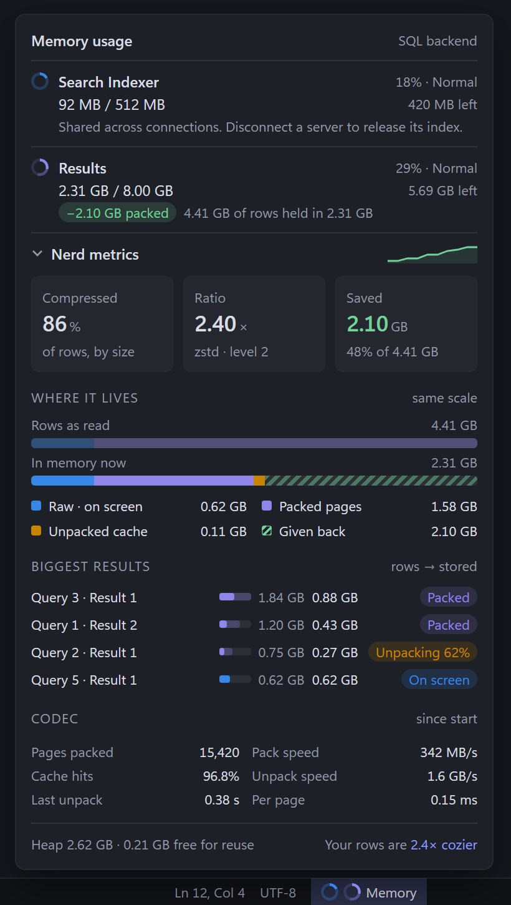
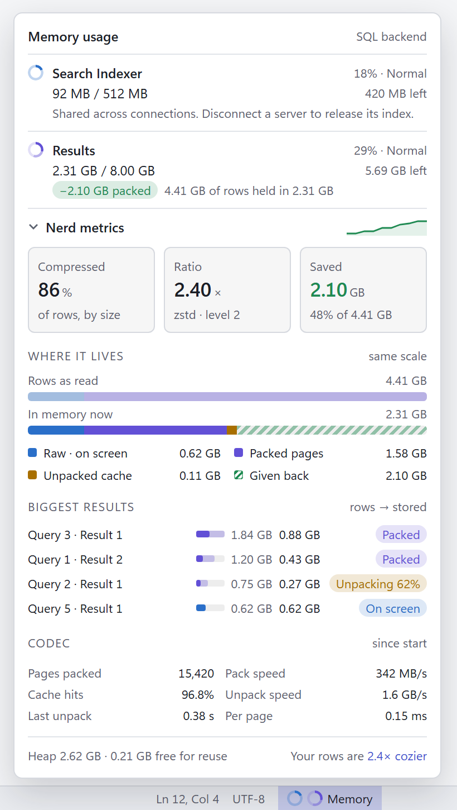

# Page compression findings

A measured prototype for compressing stored result pages, measured on 2026-11-12. This is a benchmark and design page.
The rule agreed with the owner still holds: results stay in memory and never spill to disk.

**Status (2026-11-14):** every step of the [proposed PR order](#proposed-pr-order) is in. The product packs every
complete result of 1 MiB or more that no window has shown for 5 seconds (stage 1, `ResultPacker`), and a shown one
once it has been idle for 30 seconds (stage 2); fused reads cover every whole-result operation but a search through a
view far from its pages' order, a diff whose first result is read far from its pages' order, a transposed Copy or Save,
and a pivot or extract refused its rooms, and the Memory panel's Nerd metrics report the packed figures. See
[Stage 1 as built](#stage-1-as-built) and [Stage 2 as built](#stage-2-as-built) for where they differ from the design below.

The first version of this page measured only what .NET 10 has (Brotli, Deflate, ZLib) and recommended Brotli. The
owner pointed at zstd and LZ4 and moved the backend to .NET 11 (STS, #459), whose `System.IO.Compression` has
Zstandard built in. This version measures both on .NET 11, and the recommendation changes with them.

## Summary

- **Codec: Zstandard at level 2, built into .NET 11 (`ZstandardEncoder.TryCompress`, window 18), one page at a
  time.** On realistic pages it stores a result in **36 to 52 % of its memory** (ratio 1.9 to 2.8), slightly better
  than Brotli 1. It decompresses a 256 KiB page in about 0.15 ms on one thread, against Brotli's 0.65 ms, and
  compresses one in about 0.7 to 1 ms. A whole 8 GiB result compresses in 1.5 to 2.0 s on the results' 16 workers and
  decompresses in 0.36 s (1.1 to 1.2 s into new arrays).
- **LZ4 is faster still but saves too little.** It decompresses about twice as fast as zstd (3 to 3.8 GB/s a thread),
  but its ratio is 1.1 to 1.5: it saves 12 to 34 % of memory where zstd 2 saves 48 to 64 %. LZ4 HC reaches 1.4 to 2.1
  but compresses at 70 to 80 MB/s. zstd's own fast levels (−1, −5) behave like LZ4. Brotli, Deflate and ZLib are
  matched or beaten on ratio and beaten three to four times on decompression.
- **zstd is fast enough to read compressed pages in place, so results need not be decompressed whole before use:**
  - a plain `results.read` of three pages costs 0.6 ms, or 0.3 ms with a six-page cache (0.05 ms raw);
  - a screen of a sorted view, whose 256 rows come from about 250 pages, costs 4.4 to 4.9 ms when those pages are
    decompressed on the 16 workers (15.5 ms on 3 workers; 43 to 47 ms on one thread);
  - a Save that decompresses each page as it goes, on one thread, adds about 0.7 s per GiB: 1.3 to 1.8 times the raw
    Save for most shapes (Brotli added 3 to 4 s per GiB).
- **Whole-result operations cost what they cost on raw pages once their pages are decompressed.** Sort, filter,
  profile, pivot and Save matched their raw times within noise. Decompressing all of an 8 GiB result first takes 1.1 to
  1.2 s on 16 workers (0.36 s per GiB on 3 workers).
- **Fused reads, built and measured:** a sort, a filter, a profile and a pivot of a packed result now read it in
  place, each worker unpacking the page it reads into a room of its own. They hold about 4 MiB (a page a worker)
  instead of what unpacking adds (525 MiB at 1 GiB, 2.1 GiB at 4 GiB) and cost from 10 % less to 26 % more time than
  rehydrating. Sort ties that compare cells read a column extract made once. A plain Save unpacks a page at a time on
  one thread, 1.4 to 2.5 times its raw time. See [Fused reads at 1 and 4 GiB](#fused-reads-at-1-and-4-gib).
- **Distinct values, row identity, diff and search read fused too:** they hold 4 to 89 MiB instead of 0.5 to 4.2 GiB
  and cost from 25 % less to 27 % more time than rehydrating. A diff whose first result is read far from its pages' order
  still unpacks that result in place, as does a search through a sorted view. See
  [Whole-result operations fused](#whole-result-operations-fused-at-1-and-4-gib).
- **This makes compressing much more actively possible,** as the owner suggested: every complete result can be
  compressed a few seconds after it is hidden, showing it again needs no wait, and a later step can keep even visible
  results compressed. See [Recommended design](#recommended-design).
- **Memory:** compressed results return their saving to the budget at once, and the GC reuses the freed space for new
  pages without growing (4.2 to 5.3 GiB of new pages fitted with no growth in the GC heap's commit). Only giving
  memory back to the operating system needs a compacting collection, which paused 1.0 to 1.4 s for the 3 to 4 GiB
  that remained.
- **Prerequisite, done: the backend runs on .NET 11** (#459). zstd is not in .NET 10, and a NuGet wrapper would have
  added a native library.

## Environment

| | |
| --- | --- |
| Machine | Intel Core Ultra 9 285K (24 cores: 8 fast, 16 slower), 64 GB, Windows 11 Pro 10.0.26200 |
| Runtimes | .NET 11.0.0 (SDK 11.0.100) for every table unless marked; .NET 10 (SDK 10.0.403) for the first run, kept below. Release builds, workstation concurrent GC (the backend's settings) |
| Revision | `main` at `ce9d1659` plus this branch's benchmark |
| Workers | `ViewSorter.Workers` = 16 on 24 logical processors; runs with `VARIA_BENCH_CORES=4` (3 workers) are marked |
| Budget | One query budget the size of the run (1 or 8 GiB), global four times that; no memory-load check |
| LZ4 | `K4os.Compression.LZ4` 1.3.8 (managed code, no native library), referenced only by the .NET 11 build of the test project |
| Data | Synthetic only (below). No user data, SQL text or values in any output |

Four other sessions were building and benchmarking on the machine for much of the time, often at 100 % processor.
Repeated medians moved by up to 30 %, single runs by more (one raw Save of the wide shape took 6.9 s and then 19 s).
Differences smaller than that mean nothing here. Compression ratios and memory figures do not depend on load; times
do.

## Fixtures and how to run them

`dotnet run --project backend/Varia.Backend.Tests --configuration Release -- --page-compression-bench <GiB> <shape>
[--codecs name,name] [--keep name] [--no-ops]` (`PageCompressionBench.cs`), one size and shape a process so each
memory reading is its own. The LZ4 package is referenced only by the test project, for this comparison.

It fills a query budget as ingestion does (`ResultSetBuffer.BeginRow`/`TryCommitRow`, real `PageBuilder` pages and
lengths sidecars), then:

1. Each codec over a sample of 384 pages on one thread (speed, median and p99 per page), then over every page on the
   workers (ratio, speed). Every codec but the kept one is collected before the next.
2. Every operation on the raw pages. The first full pass is untimed and warms the JIT; then three timed runs, median
   reported. Without the warm pass the first raw runs were 2 to 10 times slower, because tiered compilation was still
   promoting the code.
3. A `results.read` of three pages, raw and compressed. A scroll trace through an LRU cache of 0, 6 and 24
   decompressed pages. A read of 256 rows through a view sorted by a random `int`, on one thread and on the workers. A
   Save that decompresses each page into one reused buffer just before writing it.
4. Drops the raw pages, keeping only the kept codec's (`--keep`, default `brotli1`), and reads the process's memory
   with no collection, after a non-compacting gen2 collection, after allocating new pages for the bytes saved, and
   after `ResultStore.CollectNow`'s compacting collection (timed).
5. Decompresses every page on the workers into new arrays ("rehydrate"), runs every operation again, then drops them
   and compacts again.

Codec names: `brotli<quality>`, `deflate<level>`, `zlib<level>`, `zstd<level>` (`zstdm1` is level −1), `zstd<level>r`
(one encoder and decoder kept per thread instead of the one-shot calls), `lz4` (fast) and `lz4hc3`, and `w22` for a
4 MiB window instead of one page's 256 KiB. `--codecs` picks which codecs run over all pages (the kept one always does).
`--no-ops` skips steps 2 and 5, and the view read and streamed Save of step 3. `VARIA_BENCH_CORES=n` holds the process
to n cores and the workers to what such a machine would have. It prints one JSON line per metric. It measures only and
checks nothing, and it is not part of `npm run check` or CI. The result-scale benchmark used in earlier hand runs
(`--result-scale-bench`) is not in the repository; this one borrows its way of filling the store.

### Shapes

Every cell is a deterministic function of its row and column, from a hash, so values do not repeat in patterns.
Text uses about 110 common English and business words followed by 3,900 made-up words, chosen with a heavy skew toward
the common ones, with a number every ninth word. It compresses roughly as prose and log messages do, not as repeated
filler.

| Shape | Columns | Bytes a row | What it stands for |
| --- | --- | ---: | --- |
| `orders` | 14: sequential `int` key, random `int` (200,000 values), status (6) and region (12) text, `decimal(18,2)`, `int` 1–20, increasing `datetime2(7)`, `date` 60 % NULL, random `uniqueidentifier`, e-mail, `decimal(5,2)` 85 % NULL, note of 20–300 characters 50 % NULL, `bit`, `float` | 287 | A typical OLTP query |
| `wide` | 120: key, then cycling random `int`, label of 5,000 values, random `datetime2`, `decimal`, `int` 90 % NULL, `bit` | 1,538 | A wide reporting row |
| `log` | 7: key, increasing `datetime2`, level (5), source (40), thread, message of 100–1,500 characters, `uniqueidentifier` | 927 | Text-heavy rows |
| `numeric` | 8: key, random `int` and `bigint`, `decimal(38,10)`, `float`, `date` 10 % NULL, `decimal` 30 % NULL, `int` of 16 values | 116 | Narrow numbers only |
| `w1` | `SyntheticRows` W1 | 219 | Reference only: each cell nearly repeats its neighbour, so it compresses far better than real data |

The lengths sidecar (`PageLengths`, 4 bytes a row) is 0.3 % (wide) to 3.4 % (numeric) of a result's bytes. It stays
raw in every design below, because the views read it. The ratios below are of page bodies; counting the sidecar
lowers them by 1 to 3 %.

## Codecs

1 GiB of each shape on .NET 11. "1 thread" is MB/s of page bytes over the sample (the range runs across the four
realistic shapes); "all" is every page of 1 GiB on 16 workers. The window is one page (256 KiB) unless marked: a 4 MiB
window gave the same ratio for Brotli and zstd.

| Codec | `orders` ratio | `wide` | `log` | `numeric` | `w1` | Compress, 1 thread | Decompress, 1 thread | Compress 1 GiB, all | Decompress 1 GiB, all |
| --- | ---: | ---: | ---: | ---: | ---: | ---: | ---: | ---: | ---: |
| zstd −5 | 1.27 | 1.50 | 1.24 | 1.06 | 2.66 | 620–1,460 MB/s | 2.6–6.6 GB/s | 0.11–0.16 s | 0.02–0.03 s |
| zstd −1 | 1.40 | 1.66 | 1.42 | 1.15 | 3.61 | 420–940 MB/s | 2.0–3.8 GB/s | 0.11–0.20 s | 0.02–0.04 s |
| zstd 1 | 1.96 | 2.70 | 2.03 | 1.86 | 4.89 | 370–780 MB/s | 1.4–1.8 GB/s | 0.12–0.20 s | 0.04–0.05 s |
| **zstd 2** | **2.09** | **2.80** | **2.23** | **1.93** | **5.37** | **310–380 MB/s** | **1.3–1.9 GB/s** | **0.21–0.25 s** | **0.05 s** |
| zstd 3 | 2.10 | 2.82 | 2.29 | 1.93 | 5.39 | 170–190 MB/s | 1.1–1.7 GB/s | 0.48–0.54 s | 0.05–0.06 s |
| zstd 3, encoder reused | 2.10 | 2.82 | 2.29 | 1.93 | 5.39 | 190–290 MB/s | 1.1–1.6 GB/s | 0.30–0.35 s | 0.05–0.07 s |
| zstd 6 | 2.15 | 2.92 | 2.35 | 2.00 | 5.42 | 67–74 MB/s | 1.3–1.5 GB/s | 1.4–1.8 s | 0.05–0.06 s |
| LZ4 | 1.32 | 1.51 | 1.30 | 1.13 | 2.82 | 450–680 MB/s | 3.0–3.8 GB/s | 0.13–0.16 s | 0.02–0.04 s |
| LZ4 HC 3 | 1.63 | 2.11 | 1.82 | 1.43 | 3.09 | 67–81 MB/s | 3.1–4.2 GB/s | 0.92–1.04 s | 0.02 s |
| Brotli 1 | 1.99 | 2.68 | 2.11 | 1.90 | 4.72 | 230–280 MB/s | 400–430 MB/s | 0.33–0.41 s | 0.16–0.19 s |
| Brotli 2 | 2.19 | 2.77 | 2.26 | 2.01 | 5.66 | 120–130 MB/s | 360–420 MB/s | 0.60–0.88 s | 0.18–0.30 s |
| Deflate 1 | 1.51 | 1.70 | 1.53 | 1.33 | 3.08 | 180–210 MB/s | 380–410 MB/s | 0.40–0.43 s | 0.17–0.19 s |
| Deflate 6 | 2.13 | 2.55 | 2.21 | 1.96 | 4.36 | 65–84 MB/s | 400–450 MB/s | 0.96–1.13 s | 0.16–0.18 s |

Per page, zstd 2 decompresses in a median 136 to 198 µs (p99 0.2 to 0.9 ms) and compresses in 0.7 to 1.0 ms; zstd 1
in 134 to 179 µs and 0.3 to 0.75 ms; Brotli 1 in 600 to 630 µs and 0.9 to 1.2 ms. At 8 GiB the ratios were the same to
two decimals (zstd 2: `orders` 2.10, `wide` 2.80, `log` 2.24), and so were the speeds per page.

Why zstd 2:

- **Decompression is what every read pays,** and zstd's is about four times Brotli's at the same or better ratio. Its
  fast negative levels and LZ4 decompress faster again, but by then decompression is no longer the cost that matters
  (0.15 ms a page against a 0.05 ms raw read of three pages), while the memory they save drops by half.
- **Level 2 over level 1:** 3 to 10 % better ratio (2.09 against 1.96 for `orders`, 2.23 against 2.03 for `log`) at
  the same decompression speed. Compression runs in the background, and level 2 is still faster than Brotli 1.
- **Level 3 and above** add under 3 % for half the compression speed or less. Reusing one encoder per thread made
  level 3 faster (context set-up is not free there) but changed little at levels −1 and 1. Level 2 was not measured
  with a reused encoder.
- **The choice is per page and can change later without a format change,** because the decoder reads any level. A
  page whose compressed size saves less than 10 % should simply stay raw.

### On .NET 10 (the first run)

The same codecs on .NET 10 had the same ratios, and their speeds were within this machine's noise of the .NET 11
figures above (Brotli 1 decompressed at 330 to 410 MB/s, Deflate 1 at 280 to 490 MB/s). Zstandard is not in the .NET 10
runtime; `ZstandardEncoder`, `ZstandardDecoder` and `ZstandardStream` are new in .NET 11's `System.IO.Compression`, and
.NET 11.0.0 ships them as released API.

## Cost to the operations that read pages

### Whole-result operations at 8 GiB

zstd 2 on .NET 11. Median of three runs, seconds. "Decompressed" is the same operation on pages decompressed into new
arrays; "decompress first" is the time to do that on 16 workers.

| Operation | `orders` raw | decompressed | `wide` raw | decompressed | `log` raw | decompressed |
| --- | ---: | ---: | ---: | ---: | ---: | ---: |
| Decompress first (all pages, 16 workers) | | 1.17 | | 1.09 | | 1.13 |
| Sort by a random `int` | 4.60 | 4.76 | 1.75 | 0.82 | 0.84 | 0.71 |
| Sort by a text | 12.5 | 12.4 | 2.24 | 1.05 | 1.31 | 1.02 |
| Filter: IN on a low-cardinality column | 0.43 | 0.44 | 0.38 | 0.22 | 0.16 | 0.15 |
| Profile of two columns | 0.96 | 0.87 | 0.19 | 0.16 | 3.05 | 2.93 |
| Pivot: count, sum, max by status | 2.35 | 2.43 | 0.59 | 0.54 | 0.66 | 0.67 |
| Save as CSV (one thread) | 6.27 | 6.56 | 10.9 | 9.76 | 1.55 | 1.56 |
| Save, decompressing each page just before it is written (one thread) | | 11.5 | | 13.7 | | 6.67 |
| The same Save with Brotli 1 (.NET 10 run) | | 28.7 | | 26.9 | | 21.5 |

(The `wide` raw sorts ran while another session was busy; the decompressed runs are the better guide there.)

- **Decompressed pages cost nothing more to read.** Every operation reads `byte[]` bodies through `PageView`.
- **Decompressing as it goes is now affordable.** One thread decompresses about 1.5 GB/s, so a one-thread streamed
  Save adds about 0.7 s per GiB: 1.3 to 1.8 times the raw Save for `orders`, `wide` and `numeric`, and 4 times for
  `log`, whose raw Save is unusually fast (5 GB/s of long text). Brotli added 3 to 4 s per GiB (4 to 12 times).
  Decompressing ahead on a second thread would hide most of it. The operations that already run on the
  workers (key builds, profile, search) would pay about 0.05 s per GiB if each worker decompressed its own pages
  (the "decompress 1 GiB, all" column). The fused path is measured below.
- **On a small machine:** with 3 workers (`VARIA_BENCH_CORES=4`), decompressing all of 1 GiB of `orders` took 0.36 s
  (0.15 s on 16), so about 3 s for 8 GiB (extrapolated).

### Fused reads at 1 and 4 GiB

`--page-compression-bench <GiB> orders --fused` fills a real store, packs the result (zstd 2) and runs each operation
three ways: on the raw result; **rehydrated** (every page unpacked on the workers first, with the bytes that adds
reserved, and packed again after; the unpacking is included in the time); and **fused** (the packed result read in
place, each worker unpacking the page it is about to read into a room of its own). Median of three runs, seconds, from
the second of two runs on a machine other sessions shared (the first run's medians differed by up to 0.4 s on the
longest operations). "Budget" is the most working memory the store charged above the result during a run; "heap" is
the most the managed heap grew, sampled every millisecond. 16 workers; `orders` packs 2.05 times. The pivot is its
groups and figures (`ResultPivoter.Build`); writing its output (`RowAccess.Hold`) is not in these figures.

1 GiB (3,686,386 rows, 4,022 pages; one-thread pack 2.5 to 3.1 s):

| Operation | raw | rehydrate | fused | budget, rehydrate | budget, fused | heap, rehydrate | heap, fused |
| --- | ---: | ---: | ---: | ---: | ---: | ---: | ---: |
| Sort by a random `int` | 0.53 | 0.42 | 0.39 | 525 MiB | 4 MiB | 1,069 MiB | 61 MiB |
| Sort by a text | 1.32 | 1.40 | 1.36 | 639 MiB | 118 MiB | 1,120 MiB | 204 MiB |
| Sort by prose text with no room for whole keys (ties compare cells) | 1.89 | 1.89 | 1.93 | 525 MiB | 305 MiB | 1,083 MiB | 365 MiB |
| Filter: IN on a low-cardinality column | 0.06 | 0.13 | 0.13 | 525 MiB | 4 MiB | 1,069 MiB | 61 MiB |
| Profile of two columns | 0.15 | 0.19 | 0.21 | 525 MiB | 4 MiB | 1,037 MiB | 34 MiB |
| Pivot: count, sum, max by status | 0.31 | 0.38 | 0.45 | 525 MiB | 8 MiB | 1,083 MiB | 122 MiB |
| Save as CSV (one thread) | 0.85 | 0.96 | 1.38 | 525 MiB | 0.25 MiB | 1,010 MiB | 1 MiB |

4 GiB (14,727,412 rows, 16,089 pages; one-thread pack 9.2 to 10.5 s):

| Operation | raw | rehydrate | fused | budget, rehydrate | budget, fused | heap, rehydrate | heap, fused |
| --- | ---: | ---: | ---: | ---: | ---: | ---: | ---: |
| Sort by a random `int` | 1.56 | 1.80 | 1.68 | 2,108 MiB | 4 MiB | 4,276 MiB | 231 MiB |
| Sort by a text | 6.07 | 5.91 | 6.17 | 2,563 MiB | 459 MiB | 4,735 MiB | 800 MiB |
| Sort by prose text with no room for whole keys (ties compare cells) | 9.26 | 9.43 | 8.51 | 2,108 MiB | 1,205 MiB | 4,390 MiB | 1,433 MiB |
| Filter: IN on a low-cardinality column | 0.22 | 0.46 | 0.43 | 2,108 MiB | 4 MiB | 4,275 MiB | 232 MiB |
| Profile of two columns | 0.48 | 0.73 | 0.82 | 2,108 MiB | 4 MiB | 4,070 MiB | 35 MiB |
| Pivot: count, sum, max by status | 1.29 | 1.50 | 1.71 | 2,108 MiB | 8 MiB | 4,502 MiB | 464 MiB |
| Save as CSV (one thread) | 3.00 | 3.17 | 5.49 | 2,108 MiB | 0.25 MiB | 4,040 MiB | 1 MiB |

- **Fused reads hold about a page a worker instead of what unpacking adds.** Rehydrating reserves the bytes unpacking
  adds (raw size less packed size: 525 MiB at 1 GiB, 2.1 GiB at 4 GiB); a fused sort, filter or profile holds 16 rooms
  of one page (4 MiB). A text sort's and a ties sort's extra is their key memory and, for ties, the column's extract
  (below), not pages. The pivot's 8 MiB is two batches of rooms (one read while the next is unpacked). Save holds one
  room (0.25 MiB).
- **On the workers' operations (sort, filter, profile, pivot) fused reads cost from 10 % less to 26 % more time than
  rehydrating** across the two runs, about 0.05 s per GiB unpacked on 16 workers, now paid in each operation instead
  of once. Rehydrating keeps the raw copy only for the operation, so a second operation pays again either way.
- **Sort ties are measured.** The ties sort orders `orders`' note (prose of 20 to 300 characters, half NULL) with no
  key memory, so its key keeps 8-byte prefixes and compares cells on ties. A key whose comparisons go back to cells
  (long exact numbers that tie as doubles, text kept as 8 bytes) extracts its column once after it is built: the
  column's cells of every page, charged as working memory (300 MiB at 1 GiB for the note column, about a quarter of
  the result). No comparison unpacks a page; unpacking a page for each comparison would have been unusable, as a sort
  compares millions of ties. If the extract is refused, the result is unpacked in place as before (its rooms and
  extracts given back first), so a sort that rehydrating could run still runs.
- **Save stays one thread and costs 1.4 to 2.5 times its raw time** across the two runs. It unpacks each page just
  before writing it, as estimated above (0.5 to 0.9 s per GiB). Decompressing ahead on a second thread was not built; a
  Save is a background job with its own progress, so it was left for later.
- The heap columns: rehydrating's is the raw copy the operation needs; fused rooms are plain arrays freed with the
  operation, so they show in the fused column while it runs.

### Whole-result operations fused at 1 and 4 GiB

`--page-compression-bench <GiB> orders --fused --whole` measures the operations that used to rehydrate, in the same
three ways and with the same columns as above: a distinct list of a low-cardinality column (status) and of a
high-cardinality one (the customer name, 3.7 million values at 1 GiB, with one search of its values), row identities
(the key found by sampling, then every row's identity), a search for text no row holds, and a diff with its unified
result (three rows of context) against a second result of the same rows with one row in 500 replaced: in the same
order, and shuffled. Rehydrating a diff unpacks both results. Median of three runs, seconds, 16 workers, one run each
on a machine other sessions shared; `orders` packs 2.05 times.

1 GiB (3,686,386 rows, 4,022 pages):

| Operation | raw | rehydrate | fused | budget, rehydrate | budget, fused | heap, rehydrate | heap, fused |
| --- | ---: | ---: | ---: | ---: | ---: | ---: | ---: |
| Distinct list, low cardinality | 0.16 | 0.11 | 0.12 | 525 MiB | 4 MiB | 1,055 MiB | 47 MiB |
| Distinct list, high cardinality, and a search of its values | 2.53 | 2.47 | 2.83 | 639 MiB | 118 MiB | 1,249 MiB | 2,180 MiB |
| Row identities | 0.06 | 0.09 | 0.08 | 525 MiB | 4 MiB | 1,066 MiB | 61 MiB |
| Search | 0.12 | 0.20 | 0.15 | 525 MiB | 4 MiB | 1,010 MiB | 5 MiB |
| Diff, second result in the same order | 0.32 | 0.38 | 0.49 | 1,067 MiB | 35 MiB | 1,935 MiB | 436 MiB |
| Diff, second result shuffled | 0.67 | 0.76 | 0.84 | 1,060 MiB | 562 MiB | 1,941 MiB | 1,439 MiB |

4 GiB (14,727,412 rows, 16,089 pages):

| Operation | raw | rehydrate | fused | budget, rehydrate | budget, fused | heap, rehydrate | heap, fused |
| --- | ---: | ---: | ---: | ---: | ---: | ---: | ---: |
| Distinct list, low cardinality | 0.19 | 0.41 | 0.42 | 2,108 MiB | 4 MiB | 4,220 MiB | 176 MiB |
| Distinct list, high cardinality, and a search of its values | 13.86 | 17.76 | 15.87 | 2,563 MiB | 459 MiB | 4,927 MiB | 6,472 MiB |
| Row identities | 0.11 | 0.38 | 0.30 | 2,108 MiB | 4 MiB | 4,264 MiB | 230 MiB |
| Search | 0.49 | 0.71 | 0.62 | 2,108 MiB | 4 MiB | 4,040 MiB | 6 MiB |
| Diff, second result in the same order | 1.16 | 1.83 | 2.06 | 4,283 MiB | 89 MiB | 9,628 MiB | 1,568 MiB |
| Diff, second result shuffled | 2.99 | 3.50 | 3.97 | 4,248 MiB | 2,244 MiB | 9,684 MiB | 5,650 MiB |

- **A distinct list, row identities and a search hold a page a worker (4 MiB) instead of what unpacking adds**, and
  cost from 25 % less to 15 % more time than rehydrating. The high-cardinality list's extra budget is its key memory, as
  raw. Its fused heap column is garbage not yet collected (its allocations, measured separately, are those of the raw
  list plus 4 MiB: the rooms and the values' row order), not memory held.
- **A distinct snapshot keeps its result's pages, not their bytes.** Its later reads and value searches go in row order
  through one room, each page unpacked once (a search of 3.7 million values unpacks each of the 4,022 pages once), and
  a result packed again after the list was built frees its raw bytes; before, the snapshot kept them alive uncharged.
- **A diff in about its pages' order holds 35 to 89 MiB instead of both results' growth** (1 and 4.2 GiB) and costs
  13 to 27 % more time than rehydrating both. The comparison reads the first result in the second's order through a few
  kept pages a run (`LeftSlots`), and the unified result, written on one thread, has each side's pages unpacked ahead on
  the workers (two batches of rooms, taken only from memory the budget can spare and given back when it has none).
  Without that the writer unpacked
  every page itself on one thread, and the in-order diff took 1.62 s at 1 GiB and 6.6 s at 4 GiB.
- **A diff whose first result is read far from its pages' order unpacks that result in place**, as before, after
  counting the unpacks its order would cost (`ResultDiffer.Local`: past four a page). It holds what unpacking the first
  result adds (562 MiB at 1 GiB) instead of both results' growth (1,060 MiB), and the second result stays packed.
- **Results not packed read as they did:** each operation's raw time matched main's within noise (1 GiB, main then
  this branch: distinct 0.12 and 0.15 to 0.16, high-cardinality 2.52 and 2.47 to 2.53, identities 0.06 and 0.06 to
  0.07, search 0.12 and 0.12, diff 0.33 and 0.31 to 0.32, shuffled 0.66 and 0.64 to 0.67).
- A search through a sorted view still unpacks first: its runs visit pages at random, so two rooms a run would unpack
  a page a row.

### Scrolling

| Read (zstd 2) | Time |
| --- | ---: |
| `results.read` of three raw pages (copying the bytes once) | 50–53 µs |
| Three compressed pages, decompressed into new arrays | 0.61–0.66 ms (p99 1.1–1.3 ms) |
| Scroll trace (forward 300 pages, back 100, 50 jumps), no cache | 0.68–0.75 ms a read |
| The same with an LRU of 6 decompressed pages (1.5 MiB) | 0.28–0.30 ms a read |
| The same with 24 pages (6 MiB) | 0.28–0.30 ms a read |
| 256 rows of a view sorted by a random `int` (≈250 source pages), one thread | 43–47 ms (Brotli 1: 158–167 ms) |
| The same pages on 16 workers | **4.4–4.9 ms** (p99 6–7 ms) |
| The same pages on 3 workers | 15.5 ms (p99 22 ms) |
| `log` (fewer rows a page: ≈58 pages), one thread / 16 workers | 10 ms / 1.4 ms |

Plain scrolling of a compressed result costs well under a millisecond. A sorted view costs a few milliseconds a
screen when its pages are decompressed on the workers, which is inside a frame on this machine and about one frame on
a 4-core one. So a result does not have to be decompressed whole before it is shown.

## Memory returned to the operating system

The process's private bytes (its commit) as the run went, MiB, keeping zstd 2. "Raw" is after the fill and a
compacting collection. "Dropped" is with the raw pages unreachable and the compressed copies held, before any
collection.

| Stage | `orders` 8 GiB | `wide` 8 GiB | `log` 8 GiB | `orders` 1 GiB |
| --- | ---: | ---: | ---: | ---: |
| Raw | 8,305 | 8,305 | 8,305 | 1,055 |
| Dropped, no collection | 16,905 | 13,234 | 15,038 | 3,747 |
| After a non-compacting gen2 collection | 16,776 | 12,956 | 14,875 | 3,660 |
| After allocating new pages for the bytes saved | 16,901 (4,223 MiB allocated) | 13,034 (5,251) | 15,027 (4,512) | 3,755 (524) |
| After a compacting collection | **4,174** | **3,037** | **3,803** | **542** |
| Pause of the compacting collection | 1.37 s | 1.05 s | 1.17 s | 0.25 s |
| After decompressing everything again, dropping it and compacting | 4,174 | 3,037 | 3,807 | 543 |

("Dropped" includes garbage from the codecs that ran before the kept one, which is why it is above raw plus
compressed.)

- **A non-compacting collection gives almost nothing back to the operating system** (0.1 to 0.3 GiB), but the space
  it frees is reused: new pages for every byte compression saved fitted without the GC heap's commit growing at all,
  and the process grew by 1 to 3 % of what was allocated. So **a compressed result's saving is real for the process
  even without compaction,** and charging the budget the compressed size at once is honest.
- **A compacting collection gives everything back,** down to the compressed bytes plus about 100 MiB. Its pause grows
  with what remains: 1.0 to 1.4 s for 3 to 4 GiB, about 0.3 s a GiB on this busy machine (`ResultStore` notes 0.1 to
  0.2 s).
- **Decompressing and compressing again leaves no residue.**
- **`ResultStore.MayCompact` will often say no** to compacting after compression alone (what remains is usually more
  than what was freed). That is fine given the reuse above.

The first run (Brotli 1, .NET 10) gave the same picture: 8.3 GiB raw to 3.2 to 4.4 GiB after compaction, 1.1 to 1.3 s
pauses, and 4 GiB of new pages after a non-compacting collection with no growth in the GC heap's commit.

## Recommended design

### What a result is

A complete result set is raw (as today) or compressed: each sealed page's body is replaced by its zstd bytes, with the
raw length beside it. `FirstRow`, `Rows` and the lengths sidecar stay as they are, so `results.rowBytes`, `CellSize`
and the row index work without decompressing anything. The page being built, and pages of an open result, are always
raw.

### Reading a compressed result

Every reader gets page bodies through one accessor instead of `StoredPage.Body`. The accessor decompresses into a
per-result cache of decompressed pages, charged to the budget as working memory:

- **`results.read` of a plain grid:** the pages it needs, through a cache of six pages (0.3 ms a read).
- **`results.read` through a view:** the distinct pages behind the rows asked for, decompressed in parallel on the
  workers (about 5 ms a screen on 16 workers, 15 ms on 3), through the same cache.
- **Whole-result operations:** a sort, a filter, a profile, a pivot and a plain Copy or Save read the packed result
  fused (step 6 below): each worker unpacks the page it is about to read into a room of its own, reserved as working
  memory, so the operation holds about a page a worker and the result stays packed. A sort whose ties compare cells
  extracts that column once. Distinct values, row identity, a diff and a search read it fused too (see
  [Whole-result operations fused](#whole-result-operations-fused-at-1-and-4-gib)). Only a search through a sorted view,
  a diff whose first result is read far from its pages' order and a transposed Copy or Save still **rehydrate** first
  (unpack every page on the workers into raw pages, after reserving what that adds, raw less packed; 0.15 s per GiB on
  16 workers, 0.36 s on 3): their readers revisit pages at random.

### When a result is compressed

Stage 1 (hidden results):

- The result is complete, not leased (Copy or Save) and not pinned by a running operation.
- It is not visible in any window, popouts included, for 5 seconds. Visibility is new information for the backend;
  the renderer sends it (a new method, see the PR order). With zstd, flicking back to a tab costs a fraction of a
  millisecond per screen, so the delay only avoids compressing results the user is still moving between.
- It is at least 1 MiB (four pages). Below that there is little to save.
- It is not a live table (`query.Live`). Live sets are small, use 64 KiB pages kept off the large object heap, and are
  replaced every tick.

Stage 2 (once whole-result operations read compressed pages in place): compress **every** complete result after it
has been idle for a few seconds, visible or not. Then the store holds raw only the pages being built, the decompressed
cache, and results an operation is reading. That is the most active option and roughly doubles what the budget holds.
It is a separate step because it depends on the fused reads, and because the grid's visible result would then pay
0.3 ms a scroll read that today costs 0.05 ms. That is invisible in a frame, but it should be measured in the app
before it becomes the default.

(As built, stage 1 packs on a thread of its own instead, compressing at the lowest priority: see [Stage 1 as built](#stage-1-as-built).)
Compression runs in the background on the results' workers, through `ViewSorter.Gate` at the lowest priority, page by
page, at about 0.2 s of 16 workers per GiB. A visible operation that needs the workers stops it between pages. A
result being compressed stays readable: each page switches when its compressed copy is ready.

### How the budget is charged

- **A compressed page is charged its compressed length plus `PageOverhead` plus its sidecar,** as a raw page is
  charged today. Compressing returns the difference to the query and global budgets at once.
- **The decompressed-page cache is working memory** (six pages, about 1.5 MiB a result, plus a view screen's pages
  while it is read), freed when the result is released.
- **Rehydrating reserves the raw size first** (`TryReserve`, refused under high system memory load as rows are). If it
  is refused in stage 1, plain and view reads still work through the cache, and the operation answers `TOO_LARGE`, as
  a sort that does not fit does today. In stage 2 this case goes away. Nothing is ever dropped or written to disk.
- **Returning memory to the operating system follows `ResultStore.CollectNow`.** Count the bytes compression frees as
  freed, so compression triggers the same collections as a release, and do not force a compaction for compression
  alone: the space is reused anyway, and a forced compaction would pause the backend for 0.3 s a GiB that remains.

### Derived results, views and live tables

- **Pivots and diffs** are result sets (`Derived`) and follow the same rules as any result.
- **Views** (sort orders, filter masks, `KeyMemory`) are not pages and are not compressed. Releasing a hidden view's
  key memory is a separate question, left alone here.
- **Live tables** are never compressed.

### What the memory panel shows

The status bar's Memory popover (status-bar-memory.md) keeps its two rows and gains a collapsible **Nerd metrics**
section for compression. This mock, made with Varia's dark and light palettes and the popover's spacing, was
accepted as the direction; the figures in it are illustrative, chosen to agree with the zstd 2 measurements above.

- **The Results row** still charges the budget's bytes ("2.31 GB / 8.00 GB"), because that is what the budget sees.
  Its ring has two tones: the solid arc is memory held, the faint arc the rows' size as read. A chip under it says
  how much compression gave back ("−2.10 GB packed") and how many bytes of rows that memory holds.
- **Three tiles:** the share of rows compressed, by size; the ratio over packed pages with the codec and level; and
  the bytes saved with their share of the rows as read.
- **Where it lives:** two bars on one scale, rows as read above and memory now below, split into raw pages (results on
  screen), packed pages, the decompressed-page cache, and a hatched part for what was given back.
- **Biggest results:** the largest results with their size as read, stored size, and state (Packed, Unpacking with
  its progress while an operation rehydrates, or On screen). Names follow the Results tab's captions.
- **Codec counters:** pages packed, cache hit rate, the last unpack's time, and pack and unpack speeds and time per
  page since the backend started.
- **Footer:** the managed heap and the part free for reuse, which explains why the operating system's figure lags the
  budget (see Memory returned to the operating system), and a light line ("Your rows are 2.4× cozier") for the fun of
  a panel for the curious.

The section is collapsed by default; its open state is a setting. Everything in it comes from the `results.memory`
events the backend already pushes to the status bar, extended with compressed bytes, cache bytes, per-result sizes and
codec counters: no polling or new timers in the renderer. The popover grows from 350 to about 384 px wide.

## What it would save

Compressed results take 36 to 52 % of their raw memory in these shapes (1.9 to 2.8 times smaller; less if the data
is mostly random numbers or GUIDs, more for repetitive text). In budget terms:

- A 16 GB machine has an automatic budget of 4 GiB (2 GiB a query). Stage 1: two hidden 1 GiB results (`orders`-like)
  hold about 1 GiB instead of 2 GiB. Stage 2: the same 4 GiB holds about 8 to 11 GiB of such results.
- A 64 GB machine (16 GiB, 8 GiB a query) with an 8 GiB result in a hidden tab gets back about 4.1 GiB of budget, and
  that much of the process's memory once a compacting collection runs.
- A session whose results are kilobytes or a few megabytes (the common case) gains little. The 1 MiB floor keeps
  the smallest raw, and the feature costs them nothing.

How large real users' results are, and how many tabs keep them, was not measured. These are worked examples, not a
forecast.

## Risks

- **.NET 11 is an STS release.** Its support is shorter than .NET 10's LTS, so the backend moves to .NET 12 (LTS) when
  that ships. The move itself (#459) passed the full live suites.
- **Correctness surface.** Every reader moves behind the accessor. A missed call site would read compressed bytes as a
  page and fail with "Unsupported result page" (`PageView.Parse` checks the header). The offline checks need a mode
  that compresses every complete result at once, so the whole suite runs against compressed results.
- **Readers that revisit cells at random.** A sort whose keys tie re-reads cells; with compressed pages each re-read
  may decompress a page. Through the cache this is bounded, but it is the case to measure in stage 2 (a text column
  with many equal 8-byte prefixes, or a long `decimal`).
- **Rehydrating can be refused in stage 1** when the budget filled while the result was compressed. The user sees
  "too large to sort now"; the wording needs care.
- **Memory comes back slowly** to the operating system. The budget sees the saving at once; Task Manager may not until
  a release triggers a compaction. The status bar's memory (status-bar-memory.md) should show compressed bytes
  separately.
- **CPU in the background.** Compressing 8 GiB takes 1.5 to 2.0 s of 16 workers (about 6 to 8 s on 3 workers,
  extrapolated). As built, stage 1 packs on one thread of its own instead, compressing at the lowest priority (about 3 s a GiB) and stops for any reader.
- **Ratios depend on the data.** Results of random keys, hashes or GUIDs compress to 1.1 to 1.5 times or not at all.
  Pages that save less than 10 % stay raw.
- **The numbers come from a loaded machine.** Treat the times as ranges. Ratios and memory figures are solid.

## Stage 1 as built

`ResultPacker` (`backend/Varia.Backend/Results/ResultPacker.cs`) follows [When a result is compressed](#when-a-result-is-compressed)
with these differences, decided from the code:

- **Its own thread, not the worker gate.** The gate shares its threads fairly and has no priority, so packing through
  it would take half the workers from a visible sort. One thread packs a result page by page, compressing each page at
  the lowest priority where the operating system honours it (Windows; on Linux and macOS it competes as an ordinary thread), and leaves every worker to visible work. Everything it does under a lock or that allocates (the
  visibility lookup, renting and copying the page's buffer, replacing a page, charging the budget) runs at normal priority: a lowest-priority thread preempted while holding the
  store's or a set's lock would stall reads and new queries until the scheduler boosted it, seconds later. It is slower than 16 workers (measured below: 275 to 400 MB/s, about three
  seconds a GiB), which only delays the saving. On a machine whose processors are all busy it may barely run (the
  offline stress run showed a lowest-priority thread waiting tens of seconds); the result then simply stays raw a
  while longer.
- **One reused encoder, streamed.** The one-shot call creates and frees a native context per page, which would
  allocate while the thread is lowered, so the thread keeps one encoder, warmed at normal priority, and compresses each
  page as a stream of unknown length. A known length would make zstd choose its tables by size and resize its working
  memory whenever the size changed; with the length unknown it uses level 2's tables for inputs over 256 KiB for every
  page. Full pages are a little over 256 KiB, so they already used those tables: re-measured after the change, the
  ratios below are unchanged (orders 506 MiB, log 464 MiB packed). Only a result's short last page, or a page of very
  few narrow rows, may pack a few percent less.
- **Event-driven.** The thread sleeps until the next hidden result falls due or until a result of 1 MiB or more
  completes, `results.visibility` applies a new set, or a pin, lease or operation that stopped or undid packing ends.
- **An operation's unpack counts as a use.** A hidden result that a search through a sorted view, a comparison read far
  from its pages' order or a transposed Copy or Save has just unpacked
  waits the delay again, so a result read run after run is not unpacked and packed each time.
- **Copy and Save do not rehydrate.** A plain Copy or Save reads page by page through the cache (1.3 to 1.8 times the
  raw Save, above) and so is never refused for want of room; a transposed one unpacks the pages its rows lie on.
- **No setting.** Packing is on in every backend Varia starts (`SqlService`'s `packHidden`, which only the backend
  process passes); the checks' stores leave it off unless a check turns it on.

Measured on 2026-11-14 with `--page-compression-bench 1 <shape> --policy` (the real `ResultPacker`, a 1 GiB result,
two runs each, other sessions busy on the machine):

| | `orders` | `log` |
| --- | ---: | ---: |
| Budget charged, raw → packed | 1,039 → 506 MiB (2.05×) | 1,030 → 464 MiB (2.22×) |
| The policy's pass, one thread | 2.7 to 3.9 s (275 to 400 MB/s) | 3.4 to 3.5 s (303 to 316 MB/s) |
| Three pages read at random positions, raw → packed with a cold cache | 1 µs → 0.63 to 0.70 ms | 1 µs → 0.62 ms |
| An operation's whole unpack, 16 workers | 0.07 to 0.16 s | 0.06 s |
| A second query's fill (a quarter of the rows) alone → beside packing | 0.89 to 1.21 s → 0.80 to 1.09 s | 0.80 to 0.85 s → 0.77 to 0.78 s |

A new query stored its rows no slower while the policy packed (within noise). Reads of a packed result cost what the
codec measurements above predicted.

### Stage 2 as built

Stage 2 packs a shown result too, on the same thread and with the same rules as stage 1 (complete, 1 MiB or more, not
live, not held), once it is idle. Measured first, then each rule settled:

- **Idle means 30 seconds untouched.** No pin or lease (a read, operation, Copy or Save) has begun or ended, the result
  has not completed, and it has not been shown again, for 30 s (`ResultPacker.VisibleIdleMs`; `ResultSetBuffer.Activity`
  on `ResultStore.Clock`). A held result is in use, so the wait runs from the hold's end. The grid reads its result
  every time it scrolls, so a result the user is looking through never falls due; 30 s is long enough that a user
  reading one screen and scrolling on keeps it raw, and short enough that results left on screen in other tabs and
  groups are packed within a minute. Hidden results keep 5 s.
- **No thrash.** A read stops a pass at its next page (the set's touch count changed), keeping the pages already
  packed: the result is then `partial` in the Memory panel and falls due again 30 s after the read. Plain reads never
  unpack a result whole (they read through the six-page cache), so reading a packed result does not undo packing. Each
  operation that unpacks it whole (a search through a view far from its pages' order, a diff whose first result is read
  far from its pages' order, a transposed Copy or Save, a pivot or extract refused its rooms) doubles the wait, up to
  eight times as long (`MaxBackoff`, 4 minutes), so a result such an operation keeps reading stays raw.
- **A sorted or filtered grid stays raw.** A view's screen reads its rows' pages in the view's order, a page or so a
  row: 30 to 55 ms a 256-row screen packed against 1.2 ms raw on 16 workers (median; p99 about 145 ms against 21 ms),
  enough to show while scrolling. A shown result with an open view is not packed (a hidden one is, as before); one already
  packed when its grid is sorted or filtered, or shown again with a view open, is unpacked again on the workers' gate
  when the budget has room for it twice over and no query waits (its screens read packed pages otherwise). That
  unpack is not a use, but a hidden result with a view waits longer each time it was so unpacked, so switching tabs
  does not unpack and pack it every time. Closing its last view wakes the policy.
- **Value lists do not keep a result raw.** A distinct snapshot keeps its result's pages, not their bytes (#498), so a
  result with one open is packed as any other and its later reads go through packed pages. (Built before #498, this
  stage kept such a result raw, since the snapshot then held the raw bodies it read.) Plain scrolling packed costs
  about 0.2 ms a 1,000-row read on `orders` and 0.8 ms on `log`, a jump 0.4 to 1 ms: well inside a frame.
- **Candidates are asked again.** Packing one result for room takes seconds, so a pass asks each candidate again before
  it starts and before each page: one the user began to work with meanwhile (a view opened, an operation's unpack) is
  left alone, and the pass stops once no query still waits rather than packing every candidate for one row.
- **Operations.** Fused sorts, filters, profiles, pivots, value lists, row identity, searches and diffs read the packed
  result and leave it packed (the first sort after idle took 0.26 to 0.37 s packed against 0.36 to 0.49 s raw on
  `orders`, a little faster since it reads half the bytes). The operations that still unpack first (above) take 0.03
  to 0.05 s per 256 MiB on 16 workers, 0.13 s on 3.
- **Room for a query.** A query's row the budget refuses (its half or the global budget) no longer stops it while
  something could be packed (`ResultStore.CanMakeRoom`): the row stays open, the ingestion waits outside every lock
  (`WaitForRoomAsync`, up to 10 s a wait, 4 waits a row, 30 s in all for the query), and the policy packs, at once and at normal priority
  on the workers' gate (`ViewSorter.Gate`, a page an item, so it shares the threads fairly with sorts and reads), the
  complete results of 1 MiB or more not held that could make room: any query's for the global budget, only the query's own when its half is full,
  hidden first, then largest, one after another until no query still waits. A user is waiting, so this ignores the idle delays, but never takes a result the user is
  working with: a shown one with an open view (its screens would read packed pages with no room left for the cache), or
  one an operation unpacked and still uses (its next operation would need that room again and could be refused). The
  new query is truncated instead, as it was before. While a row waits, the rows committed before it are not yet sealed. With nothing to pack, or once the waits
  run out, the row is refused as before. Rows already stored are never dropped, and a stop is never undone: stored rows
  stay a prefix of the rows read.
- **Fairness.** Idle packing stays on the lowest-priority thread: the workers' gate shares threads fairly but has no
  priority, so packing there would take a share from a visible sort for a saving nobody is waiting on. Packing for room
  goes through the gate, since the query waiting for it is user work.
- **No setting.** On in every backend Varia starts, as stage 1 is: the measured costs are below a frame for plain
  reads, the rules above keep it away from results in use, and a setting would only let users keep half the budget idle.

Measured on 2026-11-14 with `--page-compression-bench 1 <shape> --stage2` (four results of 256 MiB, the first shown and
the others hidden; the real `ResultPacker`; other sessions busy on the machine; `orders` twice and once with
`DOTNET_PROCESSOR_COUNT=4`):

| | `orders` | `log` |
| --- | ---: | ---: |
| Budget charged: raw → stage 1 → stage 2 | 1,043 → 646 → 513 MiB (2.03× raw, 1.26× stage 1) | 1,033 → 607 → 466 MiB (2.22×, 1.30×) |
| The stage 2 pass over the shown result, one thread | 0.86 to 1.27 s (213 to 312 MB/s) | 1.13 s (238 MB/s) |
| A 1,000-row plain read while scrolling, raw → packed (median, p99) | 0.8 µs → 0.20 ms (p99 0.7 to 5 ms) | 1.2 µs → 0.77 ms (p99 1.4 ms) |
| A 1,000-row plain read at a random row, raw → packed | 1 µs → 0.42 ms (p99 0.9 to 4 ms, one run 39 ms) | 0.9 µs → 0.96 ms (p99 3.3 ms) |
| A sorted view's 256-row screen, raw → packed | 1.2 ms → 31 to 55 ms (3 workers: 1.0 → 22 ms) | 0.41 ms → 5.0 ms |
| The first sort after idle, raw → packed (fused) | 0.36 to 0.49 s → 0.26 to 0.37 s | 0.13 s → 0.28 s |
| The first whole unpack (measured on a search, before #498 fused it) | 0.04 to 0.05 s (3 workers: 0.13 s) | 0.03 s |

The six-page cache hits 2 to 6 % of lookups over these reads: the grid reads pages it has not read since they were
packed, so a cold page's cost is what matters, and it is the codec's (0.2 ms a page).

## Proposed PR order

1. **Move the backend to .NET 11.** Done in #459.
2. **One page accessor and pins.** Done in #462. Every `SealedSnapshot`/`PagesFor` reader gets bodies through one accessor and pins
   the result while it reads (a pin count beside the lease count; release waits for pins as for leases). No behaviour
   change.
3. **Compressed pages inside the store, behind an internal switch.** Done in #468. zstd 2 per page, the skip for pages that save
   under 10 %, the decompressed-page cache, parallel decompression for view reads, rehydrate with its reservation,
   budget transfer, and freed bytes counted for `CollectNow`. An offline mode that compresses every complete result,
   run as a second pass of the result checks.
4. **Visibility.** Done in #463. A `results.visibility` method in all five places (contract, zod, method policy, preload,
   `SqlService` dispatch), sent by the renderer when a result's grid is shown or hidden in any window.
5. **Stage 1 policy.** Done (see [Stage 1 as built](#stage-1-as-built)); the Nerd metrics section came first, in #464. Compress complete, unpinned, hidden results of 1 MiB or more after 5 s, on a
   thread of its own that compresses at the lowest priority. `results.memory` reports compressed bytes, and the Memory popover gets its Nerd metrics section (above).
   README, status-bar memory docs, CHANGELOG, and the Getting Started guides that show the status bar.
6. **Fused reads.** Done: sort, filter, profile, pivot and plain Copy/Save read packed pages fused, sort ties through a
   column extract; then distinct values, row identity, diff and search (measured above). Left: a search through a sorted
   view, a diff whose first result is read far from its pages' order and transposed Copy/Save rehydrate (the path
   stays for them and as the fallback of a refused extract or pivot hold); Save does not decompress ahead.
7. **Stage 2 policy.** Done (see [Stage 2 as built](#stage-2-as-built)). Compress idle shown results too, and let a
   query the budget refuses wait while the policy packs to make room.

## Not measured

- Real sessions: how big users' results are and how many tabs hold them.
- Binary columns (`varbinary`, images) and documents (xml, json, plans). The `L1` and `B1` synthetic shapes exist but
  repeat one document, so they would overstate the ratio. They were left out rather than reported.
- Fused reads with fewer workers (`VARIA_BENCH_CORES`), on `wide` and `log`, and under contention with other
  operations on the worker gate. Only `orders` on 16 workers was measured. Save with decompression ahead.
- zstd 2 with a reused encoder per thread, and zstd dictionaries (.NET 11 can train one per result, which might help
  pages of one result share their repeated text).
- Compressing a result while the grid reads it, and the worker gate's priority under contention.
- The end-to-end time in the app (renderer and IPC included). Only the backend's share was measured.
- Linux and macOS, and a real 4-core machine (`VARIA_BENCH_CORES` only restricts affinity on this one).
- The compacting collection's pause with other large results in the heap. Each run held one result.
