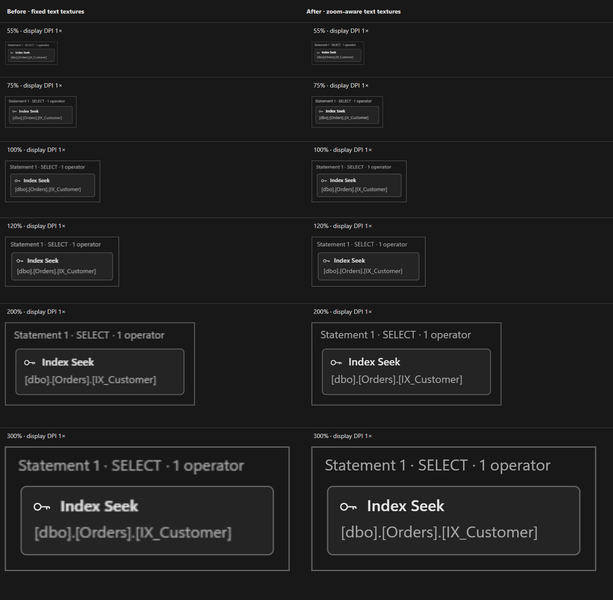
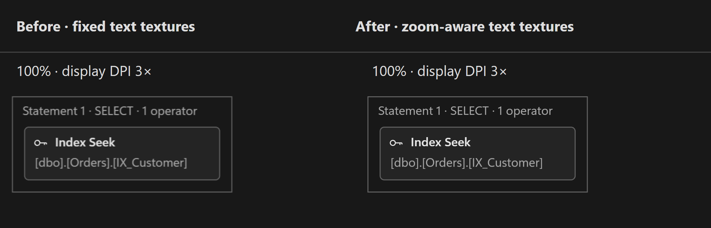

# Execution plan text quality

`PlanCanvas` previously rasterized labels at the renderer's fixed resolution, capped at 2× DPI, then scaled those textures with the camera. Text now uses the full owning window DPI, rasterizes at `renderer.resolution × camera.scale`, and snaps text quads to device pixels with `roundPixels`.

The real Pixi WebGL renderer was compared with `PlanCanvas.ts` from `1be5ef0b1a4fdb3b353f85a4611d1f6f86256ef5`, sharing the same layout, fonts, theme and fixture data. The camera deliberately has fractional translations. The matrix covers 55%, 75%, 100%, 120%, 200% and 300% zoom at 1×, 1.25×, 2× and 3× display DPI: 24 pairs of actual canvases.

Visual inspection found the clearest improvement at 120–300% on a 1× display: headings, operator names and object captions have sharper glyph edges. Pixel snapping also reduces blur at 100%. Fractional DPI samples improve more subtly. Removing the 2× cap visibly improves 100% zoom on a 3× display. Labels at 55% remain very small; native pixel density cannot make such small text as readable as 100%.

Before is on the left and after is on the right. Open the images at their original pixel size to avoid adding the image viewer's own scaling.





The comparison command verifies actual WebGL text texture resolution, canvas backing dimensions, texture updates after zooming, and texture reuse during panning and unchanged counter frames. It also fails on browser console or page errors. These checks validate rendering behavior; the sharpness assessment above comes from inspecting the rendered images.

Run with an installed Chrome browser:

```sh
npm run test:plan-text-quality -- --baseline 1be5ef0b
```

`--baseline` defaults to `origin/main`; supply the pre-change revision when comparing after this fix is merged. To select a browser executable explicitly in PowerShell:

```powershell
$env:VARIA_BROWSER_EXECUTABLE = 'C:\Program Files\Google\Chrome\Application\chrome.exe'
npm run test:plan-text-quality -- --baseline 1be5ef0b
```

Outputs are `artifacts/plan-text-quality/comparison-{dpi}x.png`, `comparison.html`, and `results.json`. The report records the baseline commit, current source hash, browser version and each label's GPU texture resolution. The generated HTML uses a local script bundle with strict CSP and no network requests, so it works without a dev server. The comparison is a focused renderer check; it does not replace Electron integration checks.

Zooming regenerates visible text textures. Panning and unchanged counters keep their existing textures. This improves fidelity at the cost of additional rasterization during zoom; it preserves the existing culling and bounded label pool.
