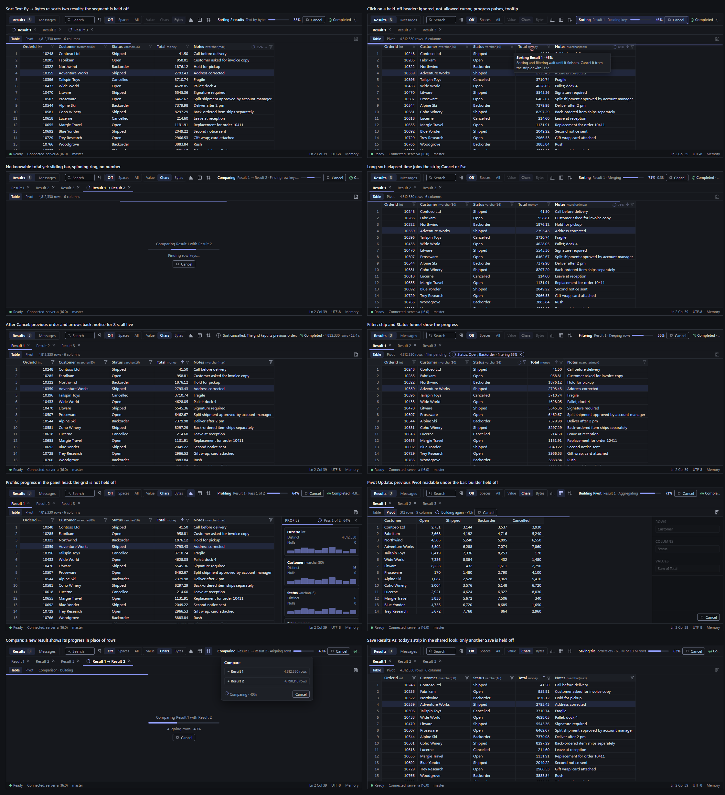
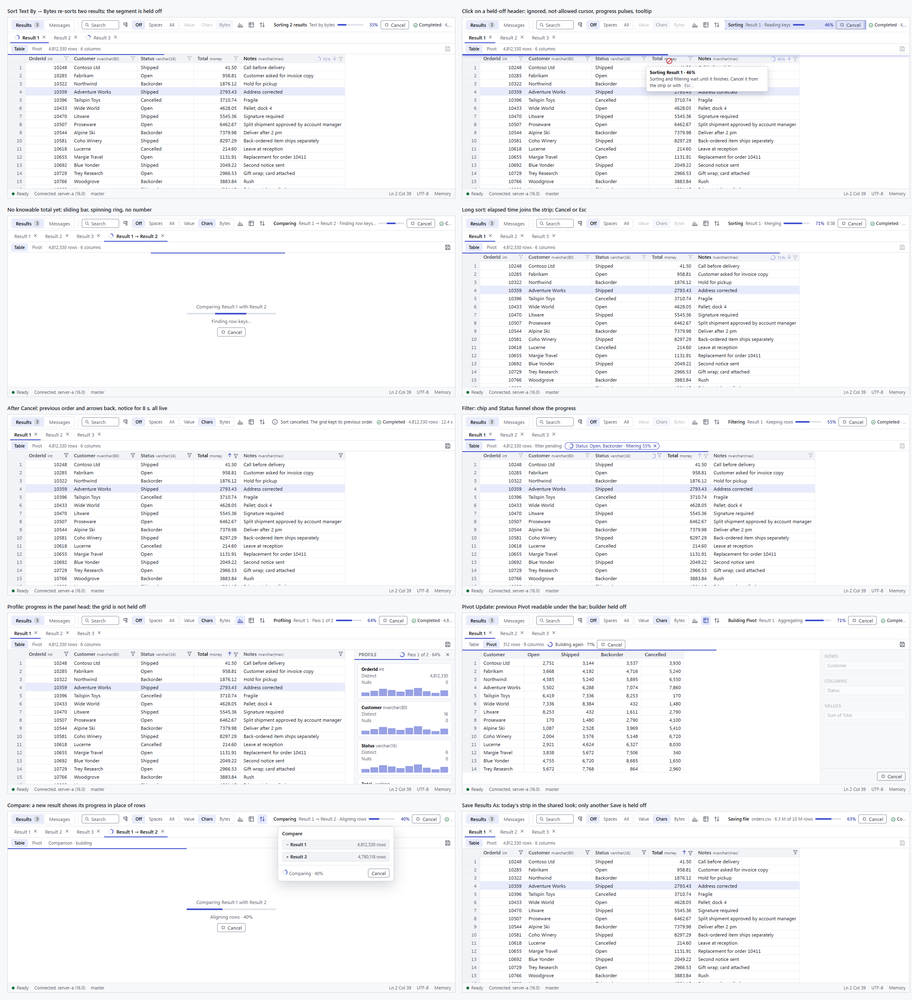

# Progress for operations on a whole result

Sort, filter, column profile, pivot, Compare, distinct values, Copy and Save run in the backend over the whole result.
On results of hundreds of MiB or several GiB, packed pages included, they take seconds. While one runs, the results
pane shows its progress in one place, holds off the controls that would start it again, and keeps everything else live.

The pieces: the backend's `op.progress` EVENTs (docs/ipc.md, Sorted views), `ResultOperations` as the one busy state
(docs/architecture.md), the results toolbar's strip, the grid's bar and the header ring. The design mock is
[prototypes/results-pane/result-operation-progress.html](../prototypes/results-pane/result-operation-progress.html)
(`?state=<id>&option=B&theme=light`); its placements A and C were not built.

## What the backend reports

Every operation knows its rows and pages before it starts (`SealedSnapshot`), and its parallel work runs page by page
or slice by slice through `WorkerGate`, so most phases have an honest fraction:

| Operation | Phases | Percentage |
| --- | --- | --- |
| Sort | filters (pages), keys (pages × sort keys), sort slices, merge rounds (log2 slices), map back | One figure across phases, weighted by the sorter's cost model (`SortCost`) |
| Filter | value keys and the keep pass per filtered column (pages, rows) | Yes |
| Profile | pass 1 (pages), merge, pass 2 for histograms (pages, only when needed) | Yes; pass 2's share is known once pass 1 merges |
| Distinct values | keys, scan, group or sort and runs | Yes |
| Pivot | keys, grouping, aggregation (pages, one thread), write (rows) | Yes |
| Compare | finding row keys, match, align, write | None while finding row keys (it tries key candidates until one holds); yes from matching on |
| Copy, Save | rows written of a known total (`job.progress`) | Yes |

Each page or slice item bumps one `Interlocked` counter (an item is a page or at least 32K rows, so there is no
contention), and a Stopwatch-throttled droppable EVENT goes out on the request at most every 250 ms, as `job.progress`
and `action.progress` do: `{ type: 'op.progress', phase, percent? }`, `percent` left out while a phase has no total. The
backend computes the percentage, which never moves backwards. Main validates the event and the results worker forwards it to the renderer. Nothing polls, and
nothing touches the grid's paint path.

## What the user sees

- **At once:** the sort arrow turns (or the filter chip changes). The grid keeps showing the previous view while the
  new one is built (`ResultGrid` swaps it in when ready).
- **After 300 ms** (`operationShowDelayMs`; shown at least 500 ms, `operationMinShownMs`): the results toolbar's strip shows what is running, on which result, the phase, a
  meter and the percentage, and Cancel; a 2 px bar runs along the top of the grid; a ring with the percentage sits on
  the sorted column's header button or the filtered column's funnel. No status-bar mirror.
- **No knowable total:** the bar slides, the ring spins and no number shows, until a phase with a total starts.
- **After 10 s:** the elapsed time joins the strip.
- **Fast:** nothing shows for an operation that ends within 300 ms; once shown, progress stays at least 500 ms so it
  never blinks.
- **Sort Text By** sorts every grid sorted by a text column again; each running tab shows a small ring and the strip
  sums them ("Sorting 2 results 35%").
- **Filter:** the chip reads "filtering 55%" and its funnel shows the ring.
- **Profile, Pivot, Compare** show in the same strip and hold nothing off. The profile and a Pivot also use their grid's
  bar; the previous Pivot stays readable under it while the builder's fields are held off and Build turns into Cancel. A
  comparison's new result shows its progress in place of rows.
- **Copy and Save** keep their strip in the shared look; a new Copy replaces a running one, and a second Save is refused
  (`JOB_BUSY`).
- **Cancel** (the strip's button, or Escape in the grid) keeps the previous view and leaves a notice ("Sort cancelled.
  The grid kept its previous order."). A failure is said once, by the toolbar's notice, and also leaves the previous
  view.

## Held off and live

While a sort or filter is built for a grid:

- **Held off, for that grid only:** sort arrows and header clicks, funnels and filter commands (menu and palette too),
  Keep Selected Rows, Sort Text By, Save Results As, and Pivot Build and Update from it. They are `aria-disabled` (still
  focusable, with a description saying why), dimmed to the disabled opacity, and show the not-allowed cursor. A click is
  refused, never queued and never replacing the running operation: the progress shows at once if it had not yet,
  pulses, and a tooltip and the live region say why ("Sorting Result 1 46%: sorting and filtering wait until it
  finishes. Cancel it from the strip or with Esc."). Controls are held off from the first moment, but nothing dims
  before 300 ms.
- **Live:** scrolling, selecting and reading the previous view, Copy (it copies what the grid shows), Find, column
  resize, Cancel, every other result tab and grid, the editor, Execute (a re-run releases the results and so cancels),
  Close Results, and the Profile panel (it updates after the swap).

Holding off keeps one operation per grid: a second click no longer throws away seconds of work, and the user always
knows which request the grid will end on. Fast operations end before anything shows, so they pay nothing.

One source decides it: a per-entry busy state in `ResultsService` (the operation, its phase and percentage, whether it
is shown yet), read by the header, the toolbar, the commands' context keys and the panels, so no control can miss it.
Cancel and failure clear it.

## Accessibility

- The grid's bar and the strip's meter are `role="progressbar"` with `aria-valuenow` and a value text ("Sorting, reading
  keys, 42%"), and no value while indeterminate. The grid has `aria-busy` while a view is built.
- A polite live region says the start ("Sorting Result 1") once the progress shows, and the end ("Sorted", "Sort
  cancelled", or the error). Percentages are not announced.
- Focus never moves. Cancel is reachable with Tab in the toolbar, and Escape in the grid cancels, as for Copy and Save.
- Reduced motion stops the slide and the spin (the bar becomes a static fill); forced colours draw the fill in
  Highlight.
