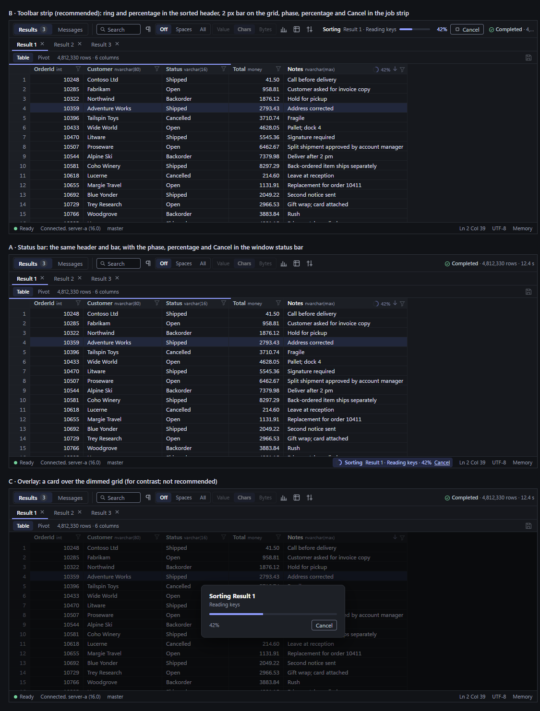
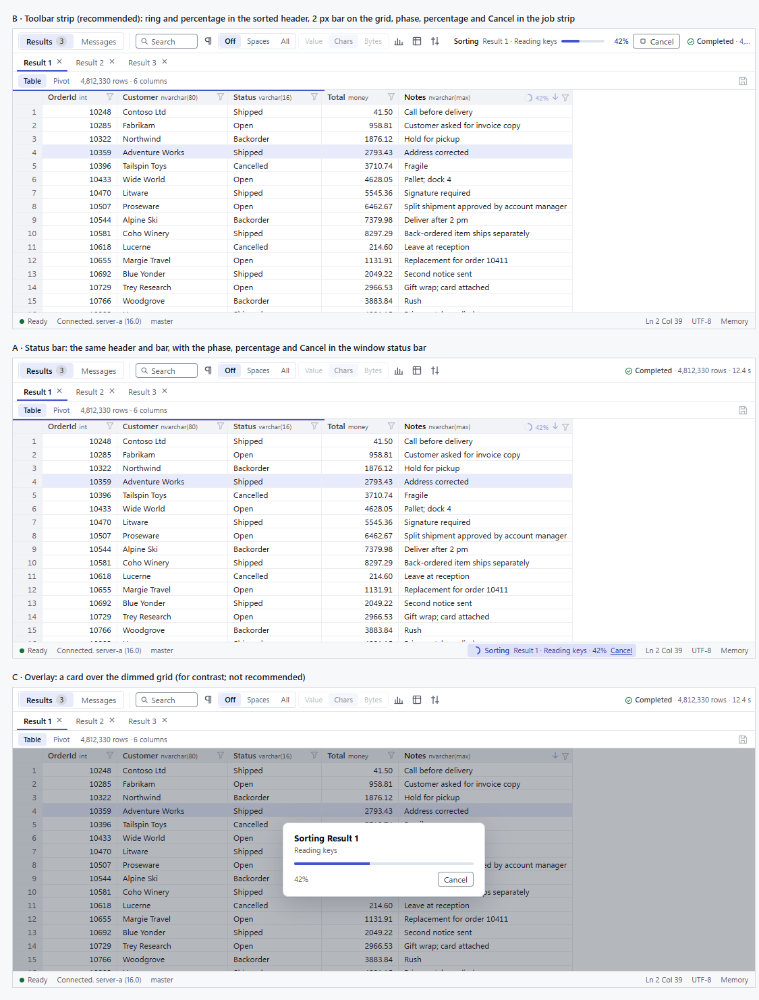

# Progress for operations on a whole result (proposal)

Status: proposal for the owner to agree. Nothing here is built yet. The interactive mock is
[prototypes/results-pane/result-operation-progress.html](../prototypes/results-pane/result-operation-progress.html): it has
a Dark / Light switch, the three placements and every state below (`?state=<id>&option=A|B|C&theme=light`).

## The problem

Sort, filter, column profile, pivot, Compare, distinct values, Copy and Save run in the backend over the whole result.
On results of hundreds of MiB or several GiB, packed pages included, they take seconds. Only Copy and Save show anything
while they run: a strip with a percentage and Cancel. A sort or filter changes the header arrow at once and then nothing
happens until the new order swaps in. Meanwhile every control stays live, so another header click, Sort Text By or a
filter starts again over the running one.

## What exists today

| Operation | Busy state today | Progress | Cancel | A second action while it runs |
| --- | --- | --- | --- | --- |
| Sort, filter (`results.view`) | `GridSort.sorting` in `ResultsService`. Nothing on screen apart from the new arrow and, for a filter, the chip's "filtering…" | none | none in the UI (a newer sort, Close Results or a re-run aborts it) | replaces it: the old request is cancelled and its answer dropped. Sort Text By re-sorts every grid sorted by a text column |
| Distinct values (funnel) | "Listing values…", `aria-busy`, placeholder rows | none | closing the popover | the funnel refuses to open while the grid sorts |
| Column profile | `aria-busy` on the panel, "Profiling…" cards | none (cards fill in, 32 columns a request) | closing the panel | a newer profile replaces it |
| Pivot (Build, Update) | `PivotService.running`; "Building again…", Build turns into Cancel | none | yes | a newer build of the same group replaces it; at most 4 pivots and comparisons a window, the rest queued |
| Compare (`results.diff`) | in the popover only: "Comparing…", Cancel | none | yes | the same pair is refused; Compare with Previous shows nothing at all |
| Copy, Save | the job strip after 300 ms: "Copying… 42% (x of y rows)", Cancel, Escape | `job.progress` rows done of a known total, 4 a second | yes | one at a time a window |

The grid keeps showing the previous view while a sort or filter is built (`ResultGrid` prepares the new view and then
swaps it in), and a failure goes back to it. None of the port operations (view, profile, distinct, pivot, diff) carries
progress: the backend could send an EVENT on the request, but `results-port.ts` passes no event handler for them.

## What the backend can report

Every operation knows its rows and pages before it starts (`SealedSnapshot`), and its parallel work already runs page by
page or slice by slice through `WorkerGate`. So most phases have an honest fraction:

| Operation | Phases | A real percentage? |
| --- | --- | --- |
| Sort | filters (pages), keys (pages × sort keys), sort slices, merge rounds (log2 slices), map back | Yes. One figure across phases weighted by their measured share (the sorter's own cost model, `SortCost`) |
| Filter | value keys and the keep pass per filtered column (pages, rows) | Yes |
| Profile | pass 1 (pages), merge, pass 2 for histograms (pages, only when needed) | Yes; the share of pass 2 is known once pass 1 merges |
| Distinct values | unpack, keys, scan, group or sort and runs | Yes |
| Pivot | keys, grouping, aggregation (pages, one thread), write (rows) | Yes |
| Compare | unpack, finding row keys, match, align, write | No while finding row keys: it tries key candidates until one holds, with no count known ahead. Yes from matching on |
| Copy, Save | rows written of a known total | Yes, today |

Cost: one `Interlocked` counter per page or slice item (each is a page or at least 32K rows, so no contention) and a
Stopwatch-throttled droppable EVENT on the request, at most every 250 ms, as `job.progress` and `action.progress` do
today: `{ type: 'op.progress', phase, done, total }`, the percentage computed in the backend and never moving backwards.
Main needs a schema and an event handler on the port's requests, and the worker a message to the renderer. Nothing new
polls; nothing touches the grid's paint path.

## Placements

All three share what sits where the eye already is: the arrow turns at once, and after 300 ms (`motion.delay`) a ring
with the percentage appears in the sorted column's header (or the filtered column's funnel and its chip), and a 2 px bar
runs along the top of the grid. They differ in where the phase, percentage and Cancel live:

- **A · Status bar.** In the window status bar. Far from the grid, and the status bar is shared by every tab and editor.
- **B · Toolbar strip (recommended).** In the results toolbar's job strip, where Copy and Save already report and
  cancel. One place for every operation on a result, next to the grid, with Cancel and Escape already learned there.
- **C · Overlay.** A card over a dimmed grid. Unmistakable, but it hides the rows the user is reading and feels modal.

## Every state (placement B)

- **Sort Text By.** The setting changes at once and every grid sorted by a text column sorts again; each running tab
  shows a small ring and the strip sums them ("Sorting 2 results 35%"). The segment is held off until all finish.
- **No knowable total.** The bar slides, the ring spins and no number shows, until the phase with a total starts.
- **Long.** After 10 s the elapsed time joins the strip. Cancel puts the previous order back at once, because nothing
  new was drawn.
- **Fast.** Nothing shows for an operation that ends within 300 ms; once shown, progress stays at least 500 ms so it
  never blinks. Controls are held off from the first moment but nothing dims before 300 ms; a click on one in that window
  brings the progress up at once. The mock's Fast state has the timeline.
- **Filter.** The chip reads "filtering 55%" and its funnel shows the ring.
- **Profile.** Only reads, so nothing in the grid is held off; the panel head carries the bar.
- **Pivot.** The previous Pivot stays readable under the bar; the builder's fields are held off, Build is Cancel.
- **Compare.** A new result: its tab shows the progress in place of rows. Comparing the same pair is held off.
- **Save and Copy.** Today's strip in the shared look; only another Save or Copy is held off.

## Held off versus live

While a sort or filter is built for a grid:

- **Held off, for that grid only:** sort arrows and header clicks, funnels and filter commands (menu and palette too),
  Keep Selected Rows, Sort Text By (it would sort again), Save Results As (which order would it save?), Pivot Build and
  Update from it. They are `aria-disabled` (still focusable, with a description saying why), dimmed to the disabled
  opacity, and show the not-allowed cursor. A click is ignored, never queued: the progress pulses once and a tooltip
  says "Sorting Result 1 46%: sorting and filtering wait until it finishes. Cancel it from the strip or with Esc."
- **Live:** scrolling, selecting and reading the previous view, Copy (it copies what is shown), Find, column resize,
  Cancel, every other result tab and grid, the editor, Execute (a re-run releases the results and so cancels), Close
  Results, and the Profile panel (it updates after the swap).

The reason for holding off rather than replacing: today a second click silently throws away seconds of work and starts
again, and with Sort Text By or a few quick clicks the user cannot tell which request the grid will end on. Holding off
with a visible reason and a Cancel keeps one operation per grid, which the owner asked for, and costs nothing for fast
operations because they end before anything shows.

One source decides it: a per-entry busy state in `ResultsService` (the operation, its phase and percentage, whether it is
shown yet), read by the header, the toolbar, the commands' context keys and the panels, so no control can miss it.
Cancel and failure clear it and leave the previous view.

## Accessibility

- The grid's bar and the strip's meter are `role="progressbar"` with `aria-valuenow` and a value text ("Sorting, reading
  keys, 42%"), and no value while indeterminate. The grid has `aria-busy` while a view is built.
- A polite live region says the start ("Sorting Result 1") once the progress shows, and the end ("Sorted", "Sort
  cancelled", or the error). Percentages are not announced.
- Focus never moves. Cancel is reachable with Tab in the toolbar and Escape in the grid cancels, as for Copy and Save.
- Reduced motion stops the slide and the spin (the bar becomes a static fill); forced colours draw the fill in Highlight.

## Open questions for the owner

1. **Placement:** B (toolbar strip, recommended), A (status bar) or C (overlay)? Or B with a mirror in the status bar
   when the results pane is collapsed?
2. **A second sort click:** held off as proposed, or should it replace the running sort as it does today (cancel and
   start the new one)?
3. **Held-off look:** dimmed with the not-allowed cursor as mocked, or left at full strength and only refusing the click
   with the tooltip?
4. **Copy and Save during a sort:** Copy allowed (copies the previous view) and Save held off, as proposed?
5. **Percentage:** one figure across phases with the phase name beside it (proposed), or a percentage per phase
   ("Merging 3 of 5")?
6. **Timings:** 300 ms before showing, 500 ms minimum once shown, elapsed time after 10 s: agreed?
