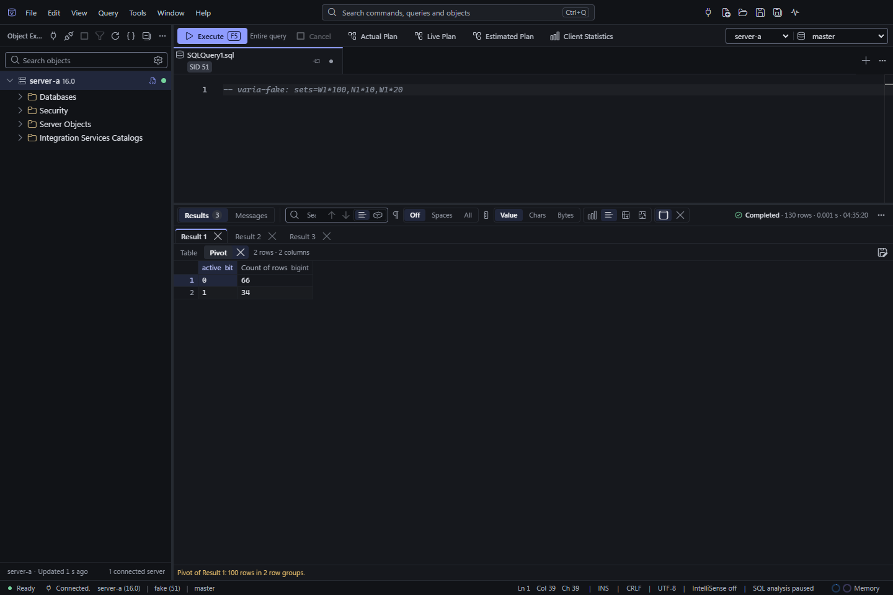
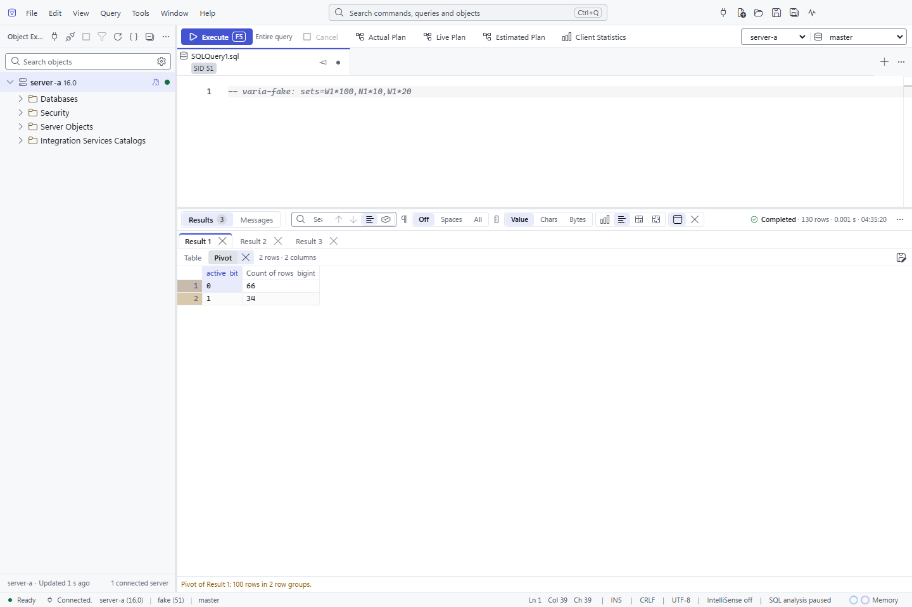

# Result grid tools

Right-click a result column header or cell, or press Shift+F10 in the grid, to open its menu.

- **Copy Column Name** copies that column's raw name only, without data, brackets or a display-name fallback. An unnamed
  column copies an empty string. Ordinary **Copy** and **Copy with Headers** keep their existing result-data formatting.
- **Fit Column** fits that column to its header and the widest measured value. It uses the same bounded measurement as
  double-clicking the column's right border: the first 4,096 rows plus the visible rows, subject to the existing width
  limits. It changes no result data or order. From the keyboard menu, it acts on the focused grid's active column.
- **Close Results**, in the grid menu, results toolbar and command palette, releases all result sets for that query and
  keeps Messages. It is unavailable while that query is executing. Hiding the results pane still keeps its results.
- The **Close** button at the end of a caption closes that view and frees its memory. A result's own ("Close Result 2")
  closes the result with its Pivot, which the button's tooltip says ("Close Result 2 and its Pivot"); a Pivot's ("Close
  Pivot of Result 2") or a comparison's closes that one alone. **Close Just This Result** in the grid menu, and **Close
  Result** in the command palette, do the same for the grid they are used on (from the palette, the grid last used).
  The other results keep their names and numbers (closing Result 2 does not rename Result 3), their sort, filters,
  selection and heights. A comparison made from a closed result stays: it copied what it compared. Anything still being
  built from the closed result (a pivot, a comparison, a sort, a copy) is cancelled; a save that has
  already started writing its file finishes. The run summary and its row count do not change. Closing the last result
  leaves the Results view saying "Results were closed. Execute the query again to see them."; Messages and captured
  execution plans stay. Closing one view is unavailable while the query is executing, and there is no undo.
- When a running query stops keeping rows because the result memory budget is full or the computer is low on memory, the
  grid's strip says so while the query keeps reading and counting rows, and offers **Stop query**. It is Cancel
  Executing Query (Alt+Pause on Windows and Linux) for that grid's query tab: Tab reaches it from the grid, and Enter or
  Space presses it. The rows already kept stay. The button goes when the query ends, and the focus returns to the grid.
  The strip for **Maximum rows kept per execution** has no button: that limit is one you set, reached as you asked, and
  the toolbar's Cancel still stops the query.

The menu keeps the query, result set and column it was opened for, including in popped-out panels. Column actions refuse
a result replaced by another execution or lost with the backend. The toolbar closes its own query's results; it does not
switch or close query documents. Closing results from the output moves focus to its surviving Results tab. Closing a
result or a comparison from its caption moves focus to the next caption, else the previous one, else the Results tab;
closing a Pivot moves it to its own result's caption. **Close Result** from the palette or a key closes the grid you
last used, and is unavailable until you have used one.

The run summary's row count is the rows the query returned: pivots and comparisons do not add to it. After a
splitter between results has been dragged, a result added later (a pivot, say) takes an average share and the others
keep their proportions.

## Groups

Each result the query returned is a group, named by its number. The stack draws one item per view, in this order:

- each result's own grid (its Table), with its **Pivot** directly under it once one is built, then the next result;
- every comparison after the results, in the order made ("Differences: Result 1 → Result 3").

A result has at most one Pivot, and a Pivot is always read from the result's own rows, never from another Pivot. The
pivot builder belongs to one result and names it as its source; there is nothing to pick. It follows the grid you last
used: that grid's result, or, when the grid is a comparison or a plan set, the first result that can be pivoted. Each
result keeps its own draft, which a re-run's result of the same number takes over. **Pivot Results…** on a Pivot's grid
opens the builder for that Pivot's result. **Build Pivot** on a result that has a Pivot replaces it: the old Pivot is
released first and the new one shown when it is built, so a build that fails or is cancelled leaves the result without
one. A Pivot shown transposed is shown transposed again after a rebuild, under the same header column when the
new Pivot still has a column of that name; its own sort, filters, column widths and selection start over. While one result's Pivot is being built the builder says so on the others, and a failed build's
message stays with the result it was for until that result's draft is edited or it is built again.

**Compare with Previous Result** compares a result's own grid with the nearest earlier result's own grid; Pivots,
comparisons and plan sets are never compared.

## Tabs

The results toolbar's **Tabs** (also **Show Results as Tabs** in the command palette and Window › Results as Tabs, and
Tools › Options › Query Results › SQL Server › Results to Grid › **Show results**, `queryResults.grid.layout`) shows the
groups one at a time instead of stacked. Stacked stays the default for now.

- A row of tabs, one per result ("Result 2") and one per comparison after them, then the selected result's view tabs:
  **Table** (**Plan set** for a SQL-returned plan set) and, once one is built, **Pivot**, with the view's rows, columns,
  batch, filters and Save Results As beside them. A comparison has no view tabs.
- One grid is mounted: the selected view's. Switching unmounts the other and releases nothing, so each grid comes back
  with its scroll, column widths, selection, orientation, sort and filters.
- The selection is the grid you last used, so the toolbar, the menus, Column Profile and the pivot builder act on the view
  shown. A result's tab returns to the view it showed last, and a Pivot built for the selected result is shown at once.
- While a query runs the first result stays selected as the others arrive; a tab you pick stays picked. After a re-run
  the result of the same number is selected again.
- Find Next onto a match in another result or view selects that tab and view, then reveals the match. From a grid (F3),
  the grid shown takes the focus and the match becomes its active cell.
- Each tab has a close button: a result's closes its Table and Pivot (its tooltip says so), a Pivot's or a comparison's
  that view alone. Closing the selected view selects its result's Table (after a Pivot), else the next tab, else the
  previous one, in the view that result showed last, and the focus goes to that tab; with nothing left, to the Results tab. Closing is unavailable while the
  query runs.
- The arrow keys, Home and End move along a row of tabs and select as they go; each row is one Tab stop.
- There is no scroll bar around the grid. The Messages strip opens by itself when the pane fits the two rows of tabs, the
  grid at its minimum height (or its rows' height, when a finished result needs less) and the strip.
- A run of more than 64 results draws 64 result tabs around the selected one, with a count of those before and after;
  the arrow keys, Home, End and Find Next reach the rest. A picker that lists them all comes with Tabs becoming the default.
- Peek's rows are never drawn as tabs.

A SQL-returned execution plan set (`SET SHOWPLAN_XML ON`, say) is a group too: it is numbered, its link opens the plan,
and closing it removes that plan from the Execution plan pane. Pivot, Compare and Transpose are unavailable for it.

The Results tab's badge counts the query's own results, not their Pivots or comparisons.

After a re-run the results come back in the same order under the same names, and the result whose grid was last used
is the one commands act on again. Pivots and comparisons are not rebuilt.

## Peek's rows

Peek's top rows are drawn bare: the grid alone, with no caption, close button, results toolbar or side panels. (A
caption appears while the grid has a filter, so the filter can be removed; when the last filter goes, focus moves to
the grid.) Copy, Save Results As, sorting, filters,
Keep Selected Rows and Transpose work as in query output; Pivot, Compare, Close Just This Result and Close Results are
not offered for a Peek grid.

The column commands are available to keyboard users through the grid's context menu and can be assigned shortcuts in
Tools > Options > Environment > Shortcuts.

## Transposed

Transposed is a way a grid is drawn, not a result: its columns as rows, named in a frozen first column, and its rows as
columns. The view keeps it with its scroll position, widths and selection, so it survives tab switches and collapsing.
Nothing is stored, so it follows the grid's sort and filters and is available while rows arrive.

| Command | What it does |
| --- | --- |
| Transpose Results (`output.transpose`) | Turns the grid transposed, or back. The toolbar's Transposed button and the grid menu's Transpose › Transposed show which it is. |
| Transpose Selected Rows (`output.transposeSelectedRows`) | Applies Keep Selected Rows, then turns the grid once the kept rows show. If that filter refuses the selection (more than 4,095 rows or 256 ranges), fails, or is replaced by another sort or filter first, the grid stays as it is. The filter stays until removed from the caption. |
| Transpose Using Column as Headers (`output.transposeWithHeaders`) | Heads each drawn column with a column's value for its row, and turns the grid. From a menu it is the column under the pointer; otherwise the active cell's. |
| Choose Headers for Transposed Results… (`output.transposeChooseHeaders`) | Lists Row number and every column, starting on the current choice. The toolbar's Headers button opens it below itself. |

They act on the menu's grid, else the focused one, else the grid that last had the focus in the query. A query's result
and a pivot can be transposed; a comparison and a plan set cannot. A Peek card's grid can, from its menu.

- A header value is written as a pivot names a column group: `NULL`, `(blank)`, cut at 128 characters. Until its rows
  are read a header reads "Row N". The header column is still drawn as a row, and is remembered while the grid is a table.
- The first 4,095 rows are drawn as columns. With more, the strip under the grid says "Showing the first 4,095 of N rows
  as columns" and suggests filtering. Find Next onto a match in a later row says so in the toolbar and does not move.
- Sort, Filter, Copy Column Name and Open Value on a transposed cell or name act on the result's own column and row.
  Fit Column fits the drawn column under the pointer (one row of the result); on a name it fits the name column.
- Copy and Save Results As write the grid as drawn (below).

## Copying and saving a transposed view

A results grid drawn transposed (its columns as rows) copies and saves what it shows; nothing is stored for it.

- Each line is one of the result's columns and each value on it one row, in the grid's current sort and filters. A block
  selected in the transposed grid copies as that block.
- With headers (**Copy with Headers**, or a save with the header option on) the first line reads `Column`, `Row 1`,
  `Row 2`… and each line starts with its column's name. When a column is used as headers, its values name the rows
  instead, as the grid's headers show them (`NULL`, `(blank)`, binary as hex, at most 128 characters); a repeated value
  gets `_2`, `_3`… so every field has its own name. That column is still written as a line.
- A JSON save is one object per column, with every value as text and NULL as `null`.
- The first 4,095 rows of the view are written, the ones the transposed grid draws. When rows are left out, the toolbar
  says how many; filter the results to copy or save others.

## Error source navigation

SQL errors with a location in the submitted query have a **Go to line** button in Messages. Activate it from the keyboard,
or double-click the error, to focus that query and reveal its line. Selection offsets and `GO` batch offsets are included.
Editing the query disables the old location; re-executing replaces it. Copying Messages includes only their text.

Procedure-relative errors and batches that can execute nested SQL have no source link: SQL Server can report a line in
the nested scope rather than the query's text. Errors without a source location, cancellation and connection failures
remain ordinary messages.
