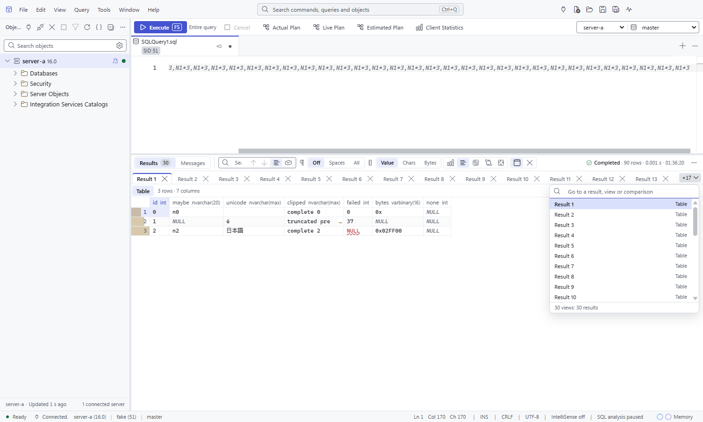
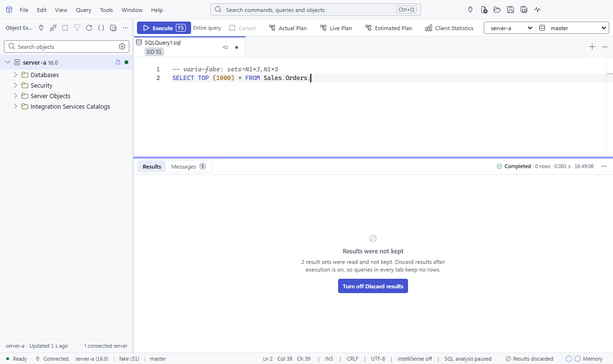

# Result grid tools

## Named results

A marker comment just before a statement names its result set: `/* #Name="Sample Query" */` or
`-- #Name="Open orders"` (`#Name` in any case, name in double quotes, inner quotes doubled, at most 128 characters).
Unnamed results keep their numbers, so naming one never renumbers another. Markers stacked before one `EXEC` name its
result sets in order, when no later statement in the batch can return a set. To SQL Server a marker is an ordinary comment.

A name is applied only when the batch's text shows which result set the statement returns. Messages says why one was
not (put `GO` between statements to name both) when the marker is inside `BEGIN … END`, a branch or a loop; after an
`EXEC`, `IF`, `WHILE` or an error in the batch; or in a batch that sets `NOEXEC`, `PARSEONLY` or `FMTONLY` anywhere or
whose text mentions SQL Server's XML plan column's name. A trigger returning rows (table, database or server DDL) can
still shift a name when its result has the named statement's column count. With `SET STATISTICS XML ON`, a plan arriving
where a `SELECT *` stood stops naming for the rest of the batch.

## Grid menu

Right-click a header or cell, or Shift+F10 in the grid. The menu keeps the query, result set and column it was opened
for (popped-out panels too); column actions refuse a result replaced by another run or lost with the backend. Column
commands can be given shortcuts in Tools > Options > Environment > Shortcuts.

- **Copy Column Name**: the raw name only (an unnamed column copies an empty string). **Copy** and **Copy with
  Headers** are unchanged.
- **Fit Column**: fits the column to its header and widest measured value, as double-clicking its right border does
  (first 4,096 rows plus visible rows, within width limits). From the keyboard menu, the active column.
- **Close Results** (grid menu, results toolbar, palette): releases all the query's result sets, keeps Messages.
  Unavailable while executing. Hiding the results pane keeps results. The toolbar never switches or closes documents.

## Sorting, filtering and highlighting

- A column header's sort button sorts ascending, then descending, then back to SQL Server's order; Shift+click adds
  further columns; the grid menu has Sort Ascending, Sort Descending, Then Sort Ascending, Then Sort Descending and Clear Sort. Text sorts by the column's
  collation, NULL first. Sorting is in memory; the query never runs again.
- With filters, the result's caption counts the rows kept ("34 of 100 rows") and lists each filter with a Remove button;
  a column's funnel stays filled while that column has a filter.
- **Highlight** (grid menu) colours rows yellow, green, blue, purple or red, while the tab is open; Ctrl+Shift+H applies the last colour picked. A highlight follows its row by a
  unique key column (else the whole row) through sorting and re-runs; when a re-run loses the key column, the grid says so and **Clear All
  Highlights** starts again.
- **Filter** (grid menu) keeps the selected cells' values, other values, the range from the lowest to the highest
  selected value, no NULLs in a column, or the rows that repeat in the selected columns or in every column. Values match
  by the column's collation. A selection across columns, contiguous or Ctrl+clicked, adds one filter a column from the
  cells selected in it, and a row must pass them all (**Filter for Selected Values** on two columns keeps the rows whose
  values match in both). Filters stack with each other and with a sort; Search, the column profile, highlights, Copy
  and Save Results As follow the filtered rows.
- A column header's funnel (**Filter Column Values…**, Alt+Down in a grid) lists every distinct value with its count,
  most frequent first or by value, as a checklist with a search, Select all, Select none and NULL as an entry; OK keeps
  the ticked values. It also filters by a condition: equals, does not equal, between, is NULL, is not NULL. From the
  keyboard: Down in the search goes to the list, the arrows, Page Up, Page Down, Home and End move through it, Space ticks
  the value, Enter is OK and Escape cancels; the list is one Tab stop, after Select all and Select none and before the
  condition.
- **Search** (results toolbar, Ctrl+F in a grid) finds matching cells in every grid of the run, in memory, comparing text
  by its column's collation; Enter and Shift+Enter (F3 and Shift+F3 in a grid, ⌘G and ⇧⌘G on macOS) step through them in each grid's order.
  Its **Columns** mode searches column names instead and fades the columns that do not match.
- **Profile** (results toolbar, or **Column Profile** on the grid menu) opens a panel with each column's NULLs, distinct
  values (exact up to 16,384, then estimated; equal under the column's collation), lowest and highest values, lengths in
  characters and bytes, and a histogram, computed in the backend over the rows the grid shows. A re-sort of a loaded
  result keeps it; it is computed again when the filters change, the result finishes loading or the query runs again.
- **Row size** draws a bar behind each row number for the row's size (the sum of DATALENGTH over its columns); hover it
  for the bytes.

## Keep Selected Rows

**Keep Selected Rows** (grid menu › Filter) keeps exactly the rows the selection covers, whatever their values, on a
Table, a Pivot or a comparison. It is one filter (one of the 16 a grid can stack), shown as "N selected rows"; a grid
has at most one, and keeping a new selection replaces it in place, or last when a duplicates filter follows it, so the
grid shows exactly the rows selected. It takes at most 4,095 rows in 256 separate ranges; a larger selection says so and
changes nothing. Rows that arrive after it was applied to a running query are not kept.

## Closing one result

A caption's **Close** button closes that view and frees its memory: a result's ("Close Result 2", tooltip "Close Result
2 and its Pivot") takes its Pivot too; a Pivot's ("Close Pivot of Result 2") or comparison's closes only that. **Close
Just This Result** (grid menu) and **Close Result** (palette; the grid last used, unavailable until one is used) do the
same. Unavailable while executing; no undo.

- Other results keep names, numbers, sort, filters, selection and heights. Comparisons made from it stay.
- Work being built from it (pivot, comparison, sort, copy) is cancelled; a save already writing finishes.
- The run summary and row count do not change.
- Closing the last result shows "Results were closed. Execute the query again to see them."; Messages, captured plans and
  Close Results (which releases them) stay; Find in Results, Find Next/Previous, Save Results As, Pivot, Compare and
  Transpose become unavailable.
- Focus goes to the next caption, else the previous, else the Results tab (a Pivot's: its result's caption; Close
  Results from the output: the surviving Results tab).

## Long operations

Sorts, filters, column profiles, Pivots and comparisons run in the backend over the whole result. Past 300 ms the results
toolbar shows the operation and result, its phase ("Reading keys", "Sorting", "Finding row keys"), a rising percentage
(none while a phase cannot tell), elapsed time after 10 seconds, and **Cancel**. A sort or filter also shows a ring on
its column's sort button and a bar along the grid's top.

- While a sort or filter runs, that grid's sorting and filtering, Keep Selected Rows, Save Results As, Sort Text By and
  Pivot Build/Update are dimmed (a click points at the running
  operation); Copy copies what the grid shows.
- Cancel, or Escape in the grid, keeps the previous order and rows.
- A grid sorted or filtered while rows arrived is rebuilt from every row once they are in; cancelling that keeps the
  partial view, and Save Results As asks to sort or filter again first.
- Screen readers hear start, end and why a click waited.

**Row memory.** When a running query stops keeping rows (result memory budget full, or the computer low on memory), the
grid's strip says so while the query keeps reading and counting, with **Stop query** (Cancel Executing Query, Alt+Pause on
Windows and Linux; Tab reaches it from the grid, Enter or Space presses it). Kept rows stay; when the query ends the
button goes and focus returns to the grid. The **Maximum rows kept per execution** strip has no button; the toolbar's
Cancel still stops the query.

After a splitter between results is dragged, a later result takes an average share; the others keep their proportions.

## Groups

Each result is a group named by its number or its `#Name`. The stack shows each result's grid (Table) with its **Pivot** under it once
built, then comparisons in the order made ("Differences: Result 1 → Result 3"). A SQL-returned plan set (`SET
SHOWPLAN_XML ON`, say) is a numbered group too: its link opens the plan, closing it removes the plan from the Execution
plan pane, and it has no Pivot, Compare or Transpose. The Results tab's badge and the run summary's row count cover only the query's own results. After
a re-run results return in the same order and names and the last-used result is again current; Pivots and comparisons
are not rebuilt.

### Pivots

- One Pivot per result, always read from the result's own rows. The builder picks row groups, an optional column
  group and values: Count, Distinct Count, Sum, Average, Min or Max (Sum and Average for numeric columns only). Text
  groups by the column's collation, NULL is a group of its own, and decimal sums keep all 38 digits. A pivot of more than
  256 column groups (fewer with many values), 100,000 row groups or 4,000,000 figures is refused with a message saying which.
- The builder belongs to the grid you last used (for a comparison or plan set, the first pivotable result) and names it.
  Each result keeps its draft, inherited by a re-run's result of the same number. **Pivot Results…** on a Pivot opens
  the builder with what that Pivot was built with.
- **Build Pivot** on a result with a Pivot replaces it once built; the old stays readable. A build that fails, is
  cancelled or does not fit leaves it and says why (the old is never freed to make room; the builder suggests closing it).
- A rebuilt Pivot keeps its place, name, focus, drawing (transposed, same header column if present), and sort keys and
  widths on columns named once in both. Filters, selection and scroll reset; the toolbar says when filters went.
- At most four builds per window (the builder says when one waits); a busy backend is retried after 1, 4 and 16 seconds.
- A failed build's message stays until the draft is edited or built again.
- The builder closes with the results (Close Results, a run with none, closing the last result) and the next run does not
  reopen it; drafts stay for the next **Pivot…**.
- A Pivot's strip says when its result holds only part of the query's rows.
- Two large Pivot builds of one query can refuse each other with `TOO_LARGE`, and a replacement counts the old Pivot's
  memory against the new one until it is built.

### Out-of-date Pivots

When its result's filters change (added, removed, replaced, Keep Selected Rows), a Pivot is **out of date**: its caption
shows "Out of date" with **Update** (in Tabs, on the row above its grid, plus a dot on its tab) and its strip says so.
Sorting, or re-applying the same values, does not mark it.

**Update** (also **Update Pivot** under Pivot Results… in the grid menu, and in the palette) rebuilds from the Pivot's own
build settings (not unbuilt builder edits) over the result as now filtered, replacing it as Build Pivot does; **Cancel**
shows on the caption meanwhile, and a failure leaves the old Pivot with the reason in the toolbar. It waits for the query
and the result's sort or filter, and is not offered once the backend has stopped.

**Automatic rebuild**, when the result stores at most 500,000 rows (stored, not filtered) and the last build took under
250 ms: a filter change rebuilds at once ("Building again…" with Cancel).

- Only a visible Pivot rebuilds (Tabs: its tab selected; Stacked: expanded; and the Results panel showing, which Messages
  in its place, or a closed or hidden panel, prevents; Messages docked beside or popped out does not). Hidden ones keep
  the mark and rebuild when shown; hiding one mid-rebuild stops it.
- A newer filter change replaces a running rebuild. A failed or cancelled one leaves the mark, says why, and is not
  retried until the filters change.
- It does not select the Pivot's tab or clear a failed Build Pivot message of yours. Like Update, it resets the Pivot's
  filters, selection and scroll, and the toolbar says so.
- Never stops a rebuild you started; a running Copy of the Pivot holds it back.

Update Pivot takes access key **U**; Pivot Results… has none (arrows and type-ahead reach it).

## Comparisons

**Compare…** (grid menu; **Compare Results…** in the palette, not offered while Results is hidden; toolbar **Compare**,
hidden when narrow) opens the Compare popover under the toolbar button or at the grid's top right. That grid is new (+),
the picked result old (−); **Swap old and new** turns them. Names read old → new ("Differences: Result 1 → Result 3").

- Offered: the run's other results with all their rows and a shared column (never Pivots, comparisons or plan sets; the
  backend refuses them too). One candidate shows no list; several show each one's rows and an amber "2 of 3 columns"
  when a column does not pair.
- First pick: your last choice on that result in this tab (partner and direction), else the nearest earlier result, which
  **Compare with Previous Result** compares at once. Exact text keeps your last choice. Only choices are remembered;
  closing the tab forgets them.
- Columns pair by name (case-insensitive), both text or both binary, repeats in order; no manual mapping. Left-out columns
  are listed (with both types when the kind differs) and named on the strip.
- Text compares by its collation, so values differing only in case or trailing spaces are underlined rather than marked
  changed; **Exact text** compares every character. When long values were compared by the part Varia keeps, the strip
  says so.
- Stored results are compared, ignoring the inputs' sorts and filters; the popover warns and the strip says so.

**Compare** (or Enter) starts it; the popover closes when it is ready and the comparison takes focus (unless you closed
the popover or switched pair meanwhile; with the palette over it, it stays and offers Show It). **Cancel** shows while it
runs; failures show in the popover, or the toolbar once it has closed. An existing identical comparison is shown (**Show
It**); asking again while it runs does nothing.

The comparison is a unified, git-style diff after the results: each changed row as its old row (−) and new row (+)
with the changed values marked, added and removed rows, and one unchanged row of context around each change, with each
row's number in both results. Rows match by a key column unique in both, else by whole rows. **Compare with Previous
Result (Exact Text)** in the palette compares every character. Comparisons share the four-per-window limit with Pivot builds, retrying a busy backend after 1, 4 and 16 seconds.
A run keeps at most 1,000 results, comparisons and Pivots (including those building); past that it is refused.

The popover closes, returning focus to its opener, on Escape, **Close**, the toolbar's Compare, a press outside or in
another window, a focus key (F6, F8), a re-run, its result or the results closing, the pane hiding or popping out or
docking, or another document showing. A picked result that closes leaves nothing picked.

A comparison's strip links its two inputs while open; a closed one reads "Result 1 (closed)".

## Tabs

The toolbar's **Tabs** (palette **Show Results as Tabs**, Window › Results as Tabs, Tools › Options › Query Results ›
SQL Server › Results to Grid › **Show results**, `queryResults.grid.layout`) shows one group at a time. Default on; off is
Stacked. It is the first toolbar tool to fold ([Narrow and short panes](#narrow-and-short-panes)).

- A tab row of results then comparisons, then the selected result's view tabs (**Table**, or **Plan set**, and **Pivot**
  once built) with rows, columns, batch, filters and Save Results As beside them.
- Only the shown grid is mounted; each returns with its scroll, widths, selection, orientation, sort and filters. The
  shown view is the current grid; a result's tab returns to its last view; new Pivots and comparisons show at once.
- While running, the first result stays selected unless you pick one; after a re-run the same number is selected.
- Find Next onto another view selects it; from a grid (F3) that grid takes focus with the match active.
- Tab close buttons work as caption ones; closing the selected view selects and focuses its Table (after a Pivot), else
  the next tab, else the previous (or the Results tab).
- Arrow keys, Home and End move and select; each row is one Tab stop. No scroll bar wraps the grid; the Messages strip
  opens itself when both tab rows, the grid's minimum height (or a small finished result's) and the strip fit.
- An overfull row scrolls sideways (wheel too), keeps the selection in view and fades the hiding edge.
- In a short pane rows fold so the grid keeps its header and two rows: first everything shares one row (counts move to the
  status line), then in the shortest pane the grid shows alone.
- Peek's rows are never tabs.

**Overflow picker.** With tabs hidden, a "+12" button at the row's end opens a themed list of every result (Pivots
indented) and comparison, with a filter box that keeps focus: type words ("27", "pivot 3"; all must match), Up, Down,
Page Up, Page Down, Enter or click to show (its tab takes focus). Escape returns focus to the button or where Go to
Result… was run; clicking outside or leaving closes it. It opens at and marks the shown view, flags out-of-date Pivots,
and keeps your row as results change. It draws only visible rows (the tab row draws at most 64). **Go to Result…**
(Ctrl+Shift+O, ⇧⌘O on macOS; palette, Window menu) opens it anywhere.

| Command | Keys | Notes |
| --- | --- | --- |
| Next / Previous Result | Ctrl+Alt+Page Down / Up anywhere; Ctrl+Page Down / Up in the Results pane (Windows, Linux) | Wraps; shows the result's last view. |
| Go to Result 1 to 8, Go to Last Result | Ctrl+1 to Ctrl+9 (⌘ on macOS) in the Results pane | Places in the tab row, whatever the names. |
| Next / Previous Result View | Ctrl+Alt+Shift+Page Down / Up | Table ↔ Pivot; not in text boxes (Monaco's column selection keeps them). Focus moves to the grid from a grid, follows from a tab, stays in the editor. |

"In the Results pane" means focus there or in the picker, with two or more results or comparisons; otherwise (Messages
and the plan included) the keys pick query tabs (Go to Query 1 to 8, Go to Last Query, Ctrl+Page Down/Up). A Results pane
closed, hidden by Toggle Results Pane (Ctrl+R) or behind another output pane comes forward for these commands; in a popout
its tab is selected (Go to Result… also raises the window). In Stacked, result commands scroll to and expand the result
(and focus its grid from a grid); view commands and the picker are Tabs-only.

## Where a result's name shows

A [named result](#named-results) shows its name wherever an unnamed one says "Result 2", keeping the number where needed.

| Surface | A named result |
| --- | --- |
| Result tab | The name, "Result 2" first among the facts beside its view tabs; tooltip "Open orders · Result 2"; accessible names "Open orders, Result 2", "Close Open orders, Result 2". |
| Caption (Stacked) | As a tab; buttons named with the number. |
| View tabs | "Views of Open orders", "Pivot of Open orders". |
| Pivot | "Pivot of Open orders" in title, builder, "Out of date" and Update's tooltip ("Build Pivot of Open orders again from Open orders as it is filtered now"). |
| Comparison | "Differences: Open orders → Result 3", strip links, columns not compared ("Price (Open orders)"); closed: "Open orders (closed)". |
| Compare popover | Name with "Result 2"; sides "Open orders · Result 2". |
| Go to Result, picker | Name with "Result 2" lighter ("Open orders, Result 2, Table"); filter matches either. |
| Grid | Accessible name "Open orders, Result 2 of 5, …". |
| Column Profile, splitter, plans | "Resize Open orders, Result 2", "Open orders, Result 2, plan 1". |
| Memory details | "Query 3 · Open orders · Result 2"; narrow panels cut the query part first. |

- Tabs showing a query-given name (or a Pivot or comparison made from one) are at most `--varia-resultTab` wide
  (docs/themes/metrics.md) with an ellipsis; such a caption's name gives way before its facts. Tooltips keep the whole name.
- Two results of one name keep it, with numbers in lists, tooltips and accessible names ("Totals · Result 2"); things named
  after one add the number: "Pivot of Totals (Result 5)", "Differences: Totals (Result 2) → Orders".
- A Pivot's or comparison's title is fixed when made.
- The first-launch query names its result ("Sample Query"); a hot-exit session with the earlier text keeps it, still
  treated as the untouched welcome query.

## Save Results As names

Suggested file names (a copy's strip names the view the same way, "Copying Pivot of Result 2… 40%"):

| Saved | Suggested file name |
| --- | --- |
| A result | `SQLQuery1-Result2.csv`; a named one `SQLQuery1-Open orders.csv` |
| Its Pivot | `SQLQuery1-Result2-Pivot.csv`, `SQLQuery1-Open orders-Pivot.csv` |
| Drawn transposed | `-Transposed` after it: `SQLQuery1-Result2-Transposed.csv` |
| A comparison | `SQLQuery1-Differences1.csv`, numbered in the order made (a closed one keeps its number) |

- A name keeps its number when it would clash: with another result's name, case-insensitively ("Totals", "totals" →
  `SQLQuery1-Totals-Result1`, `SQLQuery1-totals-Result3`); with another file name ("Result2" beside an unnamed Result 2,
  "Totals-Pivot" beside the Pivot of "Totals"); or when cut.
- Names take at most 64 characters; `\ / : * ? " < > |` become `_`, trailing dots go, and an empty result uses the number.
- The whole stays within 128 characters and 240 bytes with extension: the query tab name gives way first, then the
  result's name, never the distinguishing part (`-Result2-Pivot`).

## Narrow and short panes

The toolbar fits its own pane, so a docked or popped-out Results panel folds like a narrow window. Tools give way in
order: **Tabs**; group icons and the search box's magnifier, Previous and Next (Enter, Shift+Enter, F3, Shift+F3 still
step); **Transposed**, **Headers**, **Compare**; **Sort text by**; **White space**; the Profile, Row size and Pivot group.
The search field keeps its placeholder ("Search all results" or "Search column names") and narrows last, so **⋯** and
**Close Results** stay visible. A short pane's Pivot builder drops its explanations so **Build Pivot** stays whole.

**⋯** (More results tools) shows in Results panes at least about 400 px wide and holds every tool: Results as Tabs, Go to
Result…, Pivot…, Compare…, Transposed, Choose Headers… (while transposed), Column Profile, Row Size, Show Spaces and Tabs,
Show All White Space, Sort Text by Characters or Bytes, and Close Results.

Long names end in ellipses in tabs, captions and Go to Result…; popouts show the same names as the main window.

## Peek's rows

Drawn bare: the grid alone (a caption appears while it has a filter; when the last goes, focus moves to the grid). Copy,
Save Results As, sorting, filters, Keep Selected Rows and Transpose work; Pivot, Compare, Close Just This Result and Close
Results are not offered.

## Transposed

A way of drawing a grid: columns as rows, named in a frozen first column. The view keeps it with scroll, widths and
selection. Nothing is stored, so it follows sort and filters and works while rows arrive.

| Command | What it does |
| --- | --- |
| Transpose Results (`output.transpose`) | Toggles. The toolbar's Transposed button and the grid menu's Transpose › Transposed show the state. |
| Transpose Selected Rows (`output.transposeSelectedRows`) | Keep Selected Rows, then transposes. If the filter refuses (more than 4,095 rows or 256 ranges), fails or is replaced first, nothing changes. The filter stays until its chip is removed. |
| Transpose Using Column as Headers (`output.transposeWithHeaders`) | Heads each drawn column with a column's value, and transposes: the column under the pointer from a menu, else the active cell's. |
| Choose Headers for Transposed Results… (`output.transposeChooseHeaders`) | Lists Row number and every column, on the current choice. The toolbar's Headers button opens it. |

They act on the menu's grid, else the focused one, else the query's last-focused. Results, pivots and Peek grids can be
transposed; comparisons and plan sets cannot.

- Header values read as pivot column groups: `NULL`, `(blank)`, cut at 128 characters; "Row N" until read. The header
  column is still drawn as a row.
- The first 4,095 rows are drawn. With more, the strip says "Showing the first 4,095 of N rows as columns"; Find Next onto
  a later row says so and does not move.
- Sort, Filter, Copy Column Name and Open Value act on the result's own column and row. Fit Column fits the drawn column
  under the pointer, or the name column.

## Copying and saving a transposed view

- Each line is one result column, values in the current sort and filters; a selected block copies as that block.
- With headers, the first line is `Column`, `Row 1`, `Row 2`… and each line starts with its column name. A header column's
  values name the rows as shown (`NULL`, `(blank)`, binary as hex, at most 128 characters; repeats get `_2`, `_3`…), and
  it is still written as a line.
- JSON: one object per column, values as text, NULL as `null`.
- The first 4,095 rows are written; the toolbar says how many were left out.

## Discard results after execution

**Discard results after execution** (Tools › Options › Query Results › SQL Server › Results to Grid) reads rows and keeps
none. The status bar's **Results discarded** opens Options at the setting.

- A run that kept nothing shows how many sets were read, with **Turn off Discard results**; once off, **Execute again**
  (focused when turned off from the notice; from Options via the status bar, focus goes to the active document).
- While running, the notice says rows are not being kept.
- With a plan, the Execution plan view opens as usual with the notice on its Results tab ("Results, not kept"); the
  completion announcement gives the counts.
- Select Top 1000 Rows from Object Explorer behaves the same.
- With the setting off none of this shows, even for sets past the result-set limit.

## Error source navigation

Errors with a location in the submitted query have **Go to line** in Messages (keyboard, or double-click the error), which
focuses the query at that line, allowing for selection and `GO` batch offsets. Editing disables the old location;
re-executing replaces it. Copying Messages copies only text. Procedure-relative errors and batches that can run nested
SQL have no link (SQL Server may report a nested line); errors without a location, cancellation and connection failures
stay plain messages.
