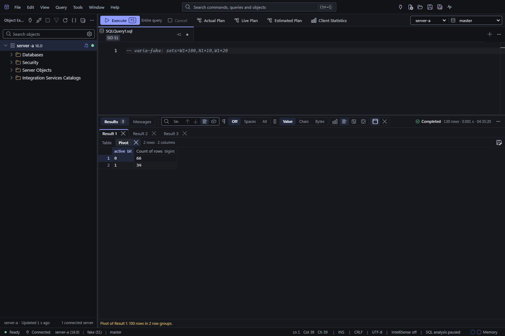
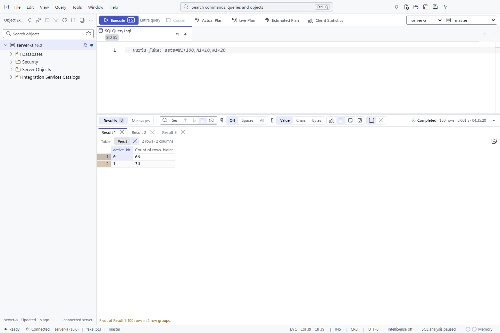
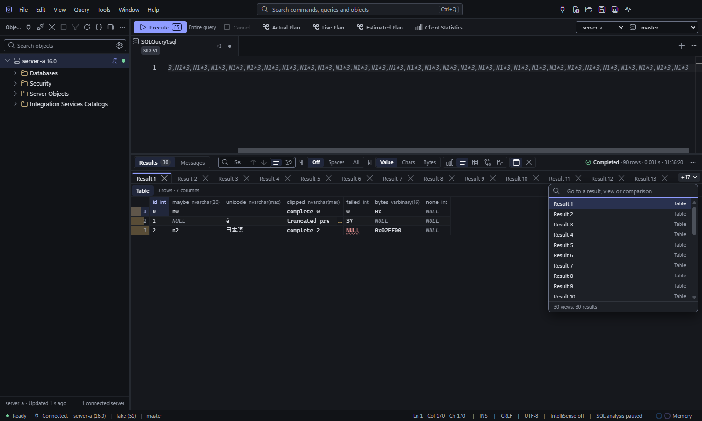
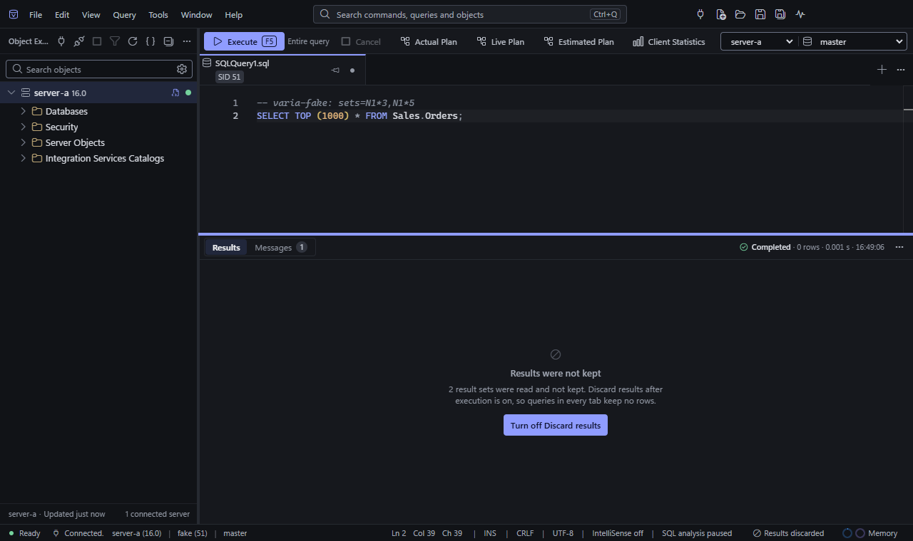

# Result grid tools

Right-click a result column header or cell, or press Shift+F10 in the grid, to open its menu.

- **Copy Column Name** copies that column's raw name only, without data, brackets or a display-name fallback. An unnamed
  column copies an empty string. Ordinary **Copy** and **Copy with Headers** keep their existing result-data formatting.
- **Fit Column** fits that column to its header and the widest measured value. It uses the same bounded measurement as
  double-clicking the column's right border: the first 4,096 rows plus the visible rows, subject to the existing width
  limits. It changes no result data or order. From the keyboard menu, it acts on the focused grid's active column.
- **Close Results**, in the grid menu, results toolbar and command palette, releases all result sets for that query and
  keeps Messages. It is unavailable while that query is executing. Hiding the results pane still keeps its results.
- The **Close** button at the end of a caption closes that view and frees its memory. A result's own ("Close Result 2")
  closes the result with its Pivot, which the button's tooltip says ("Close Result 2 and its Pivot"); a Pivot's ("Close
  Pivot of Result 2") or a comparison's closes that one alone. **Close Just This Result** in the grid menu, and **Close
  Result** in the command palette, do the same for the grid they are used on (from the palette, the grid last used).
  The other results keep their names and numbers (closing Result 2 does not rename Result 3), their sort, filters,
  selection and heights. A comparison made from a closed result stays: it copied what it compared. Anything still being
  built from the closed result (a pivot, a comparison, a sort, a copy) is cancelled; a save that has
  already started writing its file finishes. The run summary and its row count do not change. Closing the last result
  leaves the Results view saying "Results were closed. Execute the query again to see them."; Messages and captured
  execution plans stay, and so does Close Results, which releases those plans. Find in Results, Find Next and Previous,
  Save Results As, Pivot, Compare and Transpose are then unavailable, as they need a grid. Closing one view is
  unavailable while the query is executing, and there is no undo.
- When a running query stops keeping rows because the result memory budget is full or the computer is low on memory, the
  grid's strip says so while the query keeps reading and counting rows, and offers **Stop query**. It is Cancel
  Executing Query (Alt+Pause on Windows and Linux) for that grid's query tab: Tab reaches it from the grid, and Enter or
  Space presses it. The rows already kept stay. The button goes when the query ends, and the focus returns to the grid.
  The strip for **Maximum rows kept per execution** has no button: that limit is one you set, reached as you asked, and
  the toolbar's Cancel still stops the query.

The menu keeps the query, result set and column it was opened for, including in popped-out panels. Column actions refuse
a result replaced by another execution or lost with the backend. The toolbar closes its own query's results; it does not
switch or close query documents. Closing results from the output moves focus to its surviving Results tab. Closing a
result or a comparison from its caption moves focus to the next caption, else the previous one, else the Results tab;
closing a Pivot moves it to its own result's caption. **Close Result** from the palette or a key closes the grid you
last used, and is unavailable until you have used one.

The run summary's row count is the rows the query returned: pivots and comparisons do not add to it. After a
splitter between results has been dragged, a result added later (a pivot, say) takes an average share and the others
keep their proportions.

## Groups

Each result the query returned is a group, named by its number. The stack draws one item per view, in this order:

- each result's own grid (its Table), with its **Pivot** directly under it once one is built, then the next result;
- every comparison after the results, in the order made ("Differences: Result 1 → Result 3").

A result has at most one Pivot, and a Pivot is always read from the result's own rows, never from another Pivot. The
pivot builder belongs to one result and names it as its source; there is nothing to pick. It follows the grid you last
used: that grid's result, or, when the grid is a comparison or a plan set, the first result that can be pivoted. Each
result keeps its own draft, which a re-run's result of the same number takes over. **Pivot Results…** on a Pivot's grid
opens the builder for that Pivot's result, starting from what the Pivot was built with. **Build Pivot** on a result that
has a Pivot replaces it once the new one is built: the old Pivot stays readable meanwhile, and a build that fails, is
cancelled or does not fit in result memory leaves it as it was and says why (the old Pivot is never freed to make room;
the builder suggests closing it and building again). A rebuilt Pivot keeps its place, its name, the focus and the way it
is drawn (transposed, under the same header column when the new Pivot has one column of that name), and the sort keys
and column widths you set on columns whose names appear once in both; its filters, selection and scroll start over, and
the toolbar says when filters were removed. Pivots of different results build at the same time, at most four in a
window (the builder says when one waits for the others), and a busy SQL backend is asked again after
1, 4 and 16 seconds. A failed build's message stays with the result it was for until that result's draft is edited or it
is built again. Like the Compare popover, the builder goes with the results themselves: **Close Results**, a run that
leaves no result, or closing its last result closes it, and the next run does not reopen it; each result's draft is kept
for the next **Pivot…**. A Pivot's strip says when the result it was built from holds only part of its query's rows.

A Pivot records the filters of the result it was built from. When that result's filters change (a filter added, removed
or replaced, Keep Selected Rows included), its Pivot is **out of date**: its caption shows an "Out of date" mark with
**Update** (in Tabs layout, on the row above the Pivot's grid, and its Pivot tab carries a dot), and its strip says so
first. Sorting the result does not mark it, since the order of the rows changes no
figure, and neither does a filter made again of the same values: ticking the same values again in a column's filter, or
filtering by other cells that hold the same values. **Update** (also **Update Pivot** on the grid's menu, under Pivot Results…, and in the command palette for the grid you
last used) builds the Pivot again from what it
was built with, not from an edit in the builder not yet built, over the result as it is filtered now, and replaces it as
**Build Pivot** does: the old Pivot stays readable until the new one is ready, and an Update that fails, does not fit or
is cancelled (the caption offers **Cancel** while a Pivot is built again) leaves it as it was, with the reason in the
results toolbar. Update waits for the query to finish and for the result's sort or filter to be built, and is not offered
once the SQL backend has stopped. Nothing rebuilds by itself. The grid's menu shows more items than its titles have
letters, so Update Pivot takes **U** and Pivot Results… has no access key; arrow keys and typing its first letters still
reach it.

## Comparisons

**Compare…** in a result's grid menu (**Compare Results…** in the command palette, or the results toolbar's
**Compare**, which a narrow window hides) opens the Compare popover: under the toolbar's Compare when that opened it, else
at the top right of that result's grid. The grid it was opened on is the new side (+), and the result picked is the old
side (−). **Swap old and new** turns them round, and the comparison is always named old → new ("Differences: Result 1 →
Result 3"). The popover offers the run's other results that have all their rows and share at least one column with it;
Pivots, comparisons and plan sets are never offered, and the backend refuses them too. With one such result there is no
list, only the two sides; with several, each row gives the result's rows, and an amber "2 of 3 columns" when a column of
either result does not pair (a pair counts once). It first picks what you last chose on that result in this query tab (the result compared with and which
way round), in this run or an earlier one, while that result is offered; otherwise the nearest earlier result, which is
what **Compare with Previous Result** compares at once. Exact text keeps your last choice in the tab. Only a choice is
remembered (a pick, a swap, Exact text or Compare), not merely opening the popover; closing the tab forgets it.

Columns pair by name, ignoring case, and by both holding text or both binary data, a repeated name in order; there is no
manual mapping. The popover lists the columns left out only when there are any, with both types when a column of the same
name holds the other kind of data, and the comparison's strip names them too. **Exact text** compares case and trailing
spaces. A comparison reads the stored results, so the inputs' sorts and filters are not applied: the popover warns while
either input is sorted or filtered, and the strip says so.

**Compare** (or Enter) starts it, and the popover closes once the comparison is there and the comparison takes the
focus. If you close the popover meanwhile, or move it to another pair, the comparison is only added and the focus stays
where it is; with the command palette open over it, it stays and offers Show It. While it runs the popover offers
**Cancel**, and a failure is said there. Asking for a comparison the run already has (the same two results, the same way
round, the same Exact text choice) shows that one (**Show It**), and asking again while it runs does nothing.
Comparisons of other pairs run at the same time, at most four at once in a window together with Pivot builds (the rest
wait their turn); a busy backend is asked again after 1, 4 and 16 seconds before the comparison fails. A comparison
still running when the popover closes goes on, and a failure is then said in the results toolbar. A run keeps at most
1,000 results, comparisons and Pivots included (counting those still being built), so a comparison that would pass that
is refused with a sentence saying so.

Escape, **Close** or the popover's close button close it and give the focus back to what opened it; the toolbar's
**Compare** closes it too, and so does a press outside it or in another window, or a key that moves the focus elsewhere
(F6, F8). While the Results panel is hidden, Compare Results… is not offered. It also closes when the query runs again, when its result closes, with the results
themselves, when the results pane is hidden or another document is shown, and when its pane pops out or docks back. A
result picked that closes leaves it with nothing picked.

A comparison's strip starts with its two inputs: each is a link to that result's grid while that exact result is open.
Once one is closed it reads "Result 1 (closed)": the comparison copied what it compared, so it stays.

## Tabs

The results toolbar's **Tabs** (also **Show Results as Tabs** in the command palette and Window › Results as Tabs, and
Tools › Options › Query Results › SQL Server › Results to Grid › **Show results**, `queryResults.grid.layout`) shows the
groups one at a time instead of stacked. Tabs is the default (it was Stacked until the overflow picker below existed); a
choice you saved before stays. In a window 1,440 pixels wide or narrower
the toolbar's Tabs gives way, like Transposed and Compare in a narrower one; the palette and the Window menu still switch the layout.

- A row of tabs, one per result ("Result 2") and one per comparison after them, then the selected result's view tabs:
  **Table** (**Plan set** for a SQL-returned plan set) and, once one is built, **Pivot**, with the view's rows, columns,
  batch, filters and Save Results As beside them. A comparison has no view tabs.
- One grid is mounted: the selected view's. Switching unmounts the other and releases nothing, so each grid comes back
  with its scroll, column widths, selection, orientation, sort and filters.
- The selection is the grid you last used, so the toolbar, the menus, Column Profile and the pivot builder act on the view
  shown. A result's tab returns to the view it showed last, and a Pivot built for the selected result, or a new
  comparison, is shown at once (a Pivot stays behind its tab when you went back to a grid while it was built). Switching
  between Stacked and Tabs keeps the focus on the grid of the view you were in.
- While a query runs the first result stays selected as the others arrive; a tab you pick stays picked. After a re-run
  the result of the same number is selected again.
- Find Next onto a match in another result or view selects that tab and view, then reveals the match. From a grid (F3),
  the grid shown takes the focus and the match becomes its active cell.
- Each tab has a close button: a result's closes its Table and Pivot (its tooltip says so), a Pivot's or a comparison's
  that view alone. Closing the selected view selects its result's Table (after a Pivot), else the next tab, else the
  previous one, in the view that result showed last, and the focus goes to that tab; with nothing left, to the Results tab. Closing is unavailable while the
  query runs.
- The arrow keys, Home and End move along a row of tabs and select as they go; each row is one Tab stop.
- There is no scroll bar around the grid. The Messages strip opens by itself when the pane fits the two rows of tabs, the
  grid at its minimum height (or its rows' height, when a finished result needs less) and the strip.
- When the row has more tabs than fit, it scrolls sideways (the mouse wheel scrolls it too), brings the selected tab into
  view whenever the selection changes and fades the edge that hides tabs.
- When some tabs are out of view, a button at the end of the row counts them ("+12") and opens the overflow picker: a
  themed list of every result, each Pivot indented under its result, and the comparisons, with a filter box that keeps
  the focus. Type words of a name ("27", "pivot 3"; every word must match), move with Up, Down, Page Up and Page Down,
  and press Enter or click a row to show it; its tab takes the focus, scrolled into view. Escape gives the focus back to
  the button, or to where Go to Result… was run from; a press outside or the focus leaving closes it. Results arriving
  or closing while it is open keep the row you moved to. It opens at the view shown, which it marks, and a Pivot
  that is out of date says so. The list draws only the rows in view, so a run of 1,000 results costs a screenful of rows
  (the row of tabs itself draws at most 64 around the selected one). **Go to Result…** (Ctrl+Shift+O, ⇧⌘O on macOS;
  command palette, Window menu) opens it from anywhere, even when every tab fits.
- **Next Result** and **Previous Result** (Ctrl+Alt+Page Down and Up from anywhere; also Ctrl+Page Down and Up in the
  Results pane, on Windows and Linux) select the next or previous result or comparison, wrapping round; a result shows
  the view it showed last. **Go to Result 1** to **8** and **Go to Last Result** (Ctrl+1 to Ctrl+9, ⌘ on macOS, in the
  Results pane) pick one as a browser's keys pick a tab. "In the Results pane" means the focus is in it or in the
  overflow picker and the query has two or more results or comparisons; otherwise, Messages and the plan included, the
  same keys pick query tabs (Go to Query 1 to 8, Go to Last Query) and Ctrl+Page Down and Up step through queries. A
  closed Results pane opens again for these commands and Go to Result….
  **Next Result View** and **Previous Result View** (Ctrl+Alt+Shift+Page Down and Up, outside the editor's text and other
  text boxes, where Monaco's column selection keeps them) switch between the selected result's Table and Pivot. They work
  from a grid, whose focus moves to the grid shown, from a focused tab, whose focus follows, and from the editor, which
  keeps it. In Stacked, Next and Previous Result and Go to Result N scroll the stack to the result (opening it when
  collapsed) and, from a grid, focus its grid; the view commands and the picker are for Tabs.
- In a short results pane the Tabs layout folds its rows so the grid keeps room for its header and two rows: first the
  result tabs and the selected view's tabs, chips and buttons share one row (the row and column counts are left to the
  status line), then, in the shortest pane (the results pane dragged to its minimum, say), the grid shows alone, as
  Stacked's one result gives up its caption. The keys above and Go to Result… still reach every view.

- Peek's rows are never drawn as tabs.

A SQL-returned execution plan set (`SET SHOWPLAN_XML ON`, say) is a group too: it is numbered, its link opens the plan,
and closing it removes that plan from the Execution plan pane. Pivot, Compare and Transpose are unavailable for it.

The Results tab's badge counts the query's own results, not their Pivots or comparisons.

After a re-run the results come back in the same order under the same names, and the result whose grid was last used
is the one commands act on again. Pivots and comparisons are not rebuilt.

## Peek's rows

Peek's top rows are drawn bare: the grid alone, with no caption, close button, results toolbar or side panels. (A
caption appears while the grid has a filter, so the filter can be removed; when the last filter goes, focus moves to
the grid.) Copy, Save Results As, sorting, filters,
Keep Selected Rows and Transpose work as in query output; Pivot, Compare, Close Just This Result and Close Results are
not offered for a Peek grid.

The column commands are available to keyboard users through the grid's context menu and can be assigned shortcuts in
Tools > Options > Environment > Shortcuts.

## Transposed

Transposed is a way a grid is drawn, not a result: its columns as rows, named in a frozen first column, and its rows as
columns. The view keeps it with its scroll position, widths and selection, so it survives tab switches and collapsing.
Nothing is stored, so it follows the grid's sort and filters and is available while rows arrive.

| Command | What it does |
| --- | --- |
| Transpose Results (`output.transpose`) | Turns the grid transposed, or back. The toolbar's Transposed button and the grid menu's Transpose › Transposed show which it is. |
| Transpose Selected Rows (`output.transposeSelectedRows`) | Applies Keep Selected Rows, then turns the grid once the kept rows show. If that filter refuses the selection (more than 4,095 rows or 256 ranges), fails, or is replaced by another sort or filter first, the grid stays as it is. The filter stays until removed from the caption. |
| Transpose Using Column as Headers (`output.transposeWithHeaders`) | Heads each drawn column with a column's value for its row, and turns the grid. From a menu it is the column under the pointer; otherwise the active cell's. |
| Choose Headers for Transposed Results… (`output.transposeChooseHeaders`) | Lists Row number and every column, starting on the current choice. The toolbar's Headers button opens it below itself. |

They act on the menu's grid, else the focused one, else the grid that last had the focus in the query. A query's result
and a pivot can be transposed; a comparison and a plan set cannot. A Peek card's grid can, from its menu.

- A header value is written as a pivot names a column group: `NULL`, `(blank)`, cut at 128 characters. Until its rows
  are read a header reads "Row N". The header column is still drawn as a row, and is remembered while the grid is a table.
- The first 4,095 rows are drawn as columns. With more, the strip under the grid says "Showing the first 4,095 of N rows
  as columns" and suggests filtering. Find Next onto a match in a later row says so in the toolbar and does not move.
- Sort, Filter, Copy Column Name and Open Value on a transposed cell or name act on the result's own column and row.
  Fit Column fits the drawn column under the pointer (one row of the result); on a name it fits the name column.
- Copy and Save Results As write the grid as drawn (below).

## Copying and saving a transposed view

A results grid drawn transposed (its columns as rows) copies and saves what it shows; nothing is stored for it.

- Each line is one of the result's columns and each value on it one row, in the grid's current sort and filters. A block
  selected in the transposed grid copies as that block.
- With headers (**Copy with Headers**, or a save with the header option on) the first line reads `Column`, `Row 1`,
  `Row 2`… and each line starts with its column's name. When a column is used as headers, its values name the rows
  instead, as the grid's headers show them (`NULL`, `(blank)`, binary as hex, at most 128 characters); a repeated value
  gets `_2`, `_3`… so every field has its own name. That column is still written as a line.
- A JSON save is one object per column, with every value as text and NULL as `null`.
- The first 4,095 rows of the view are written, the ones the transposed grid draws. When rows are left out, the toolbar
  says how many; filter the results to copy or save others.

## Discard results after execution

With **Discard results after execution** on (Tools › Options › Query Results › SQL Server › Results to Grid), every query
reads its rows and keeps none. While it is on, the status bar shows **Results discarded**; pressing it opens Options with
the setting focused. A run that read result sets and kept none shows a notice where its grid would be, saying how many
sets were read, with **Turn off Discard results**. Once the setting is off the notice offers **Execute again**, so the
next run keeps its rows; turned off from the notice, focus moves to Execute again, and turned off from Options opened by
the status bar item, focus goes to the active document. While the run is still going the notice says rows are not being
kept. A run that also kept an execution plan opens the Execution plan view as before, with the notice on its Results tab,
which screen readers name "Results, not kept"; the run's completion announcement says how many sets were read and not
kept. Select Top 1000 Rows from Object Explorer runs the same way. Runs made with the setting off show none of this, even
when sets past the result-set limit were not kept, and results you close say they were closed.

## Error source navigation

SQL errors with a location in the submitted query have a **Go to line** button in Messages. Activate it from the keyboard,
or double-click the error, to focus that query and reveal its line. Selection offsets and `GO` batch offsets are included.
Editing the query disables the old location; re-executing replaces it. Copying Messages includes only their text.

Procedure-relative errors and batches that can execute nested SQL have no source link: SQL Server can report a line in
the nested scope rather than the query's text. Errors without a source location, cancellation and connection failures
remain ordinary messages.
