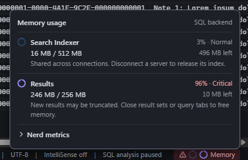
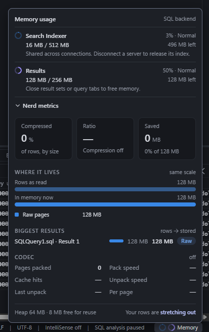

# Status bar memory meters

The Memory control sits at the bottom right of the status bar. Its blue ring shows the Search Indexer’s budget usage and its violet ring shows Results budget usage.

Hover or keyboard focus previews the breakdown above the status bar. Click, tap, Enter, or Space keeps it open. Pressing inside a preview keeps it open too. Escape or a click outside closes it, and Escape returns focus to the Memory control. Each row shows memory used, the feature’s budget, the percentage used, the remaining memory, and what happens as the budget fills.

| Feature | Yellow | Red |
| --- | ---: | ---: |
| Search Indexer | 75% | 95% |
| Results | 90% | 95% |

## Nerd metrics

Below the two rows, **Nerd metrics** opens a closer look at what results hold, for the curious. It starts collapsed; its heading (a button: click, Enter or Space) opens and closes it, and Varia remembers the choice (`environment.statusBar.memoryNerdMetrics`, not shown in Options). The heading joins the Tab order once the breakdown is kept open, so a preview opened by focus never catches the next Tab: Tab then moves from the Memory control to the heading and on to whatever follows the control, and Shift+Tab goes back the same way. Sizes read in whole MB, or in GB to two decimals once a figure in view reaches 1 GB.

The screenshot was taken before compression was switched on; with it on, the Ratio tile reads "zstd · level 2" rather than Compression off, and the Codec heading "since start" rather than off, even before anything is packed.

- **Trend:** once something is compressed, a small sparkline beside the heading follows the share of rows compression gave back over the last ten minutes, one point per report.
- **Tiles:** the share of rows compressed, by size; the compression ratio with the codec and its level; and the bytes compression saved, as a share of the rows as read.
- **Where it lives:** two bars on one scale, the rows as read above and the memory holding them below, split into raw pages, packed pages, the cache of unpacked pages, and a hatched part for what compression gave back. Each bar has a text equivalent.
- **Biggest results:** the eight largest results, named by their query tab and Results caption ("Query 3 · Result 1"; a live view's table, or a result no tab shows, is named as such), with their size as read, their stored size and their state (Raw, Partly packed when packing stopped part way, for a read or because it was shown again, Packed, or Unpacking with its progress).
- **Codec:** pages packed, cache hit rate, the last unpack's time, pack and unpack speeds and the time per page, since the SQL backend started. Packing runs at low priority, so its speed is elapsed time and reads lower while other work keeps the processors busy.
- **Footer:** the managed heap and the part of it free for reuse, which is why the operating system's figure for the backend can stay above what results hold, and a light line on how cozy your rows are.

When results are compressed ([page-compression-findings.md](page-compression-findings.md) has the detail):

- **Hidden results:** a complete result of 1 MB or more that no window has shown for 5 seconds is packed in the background, and showing it again needs no wait.
- **Results on screen** are packed once idle for 30 seconds (no scrolling, sort, Copy or Save; longer each time an operation has had to unpack it), sorted and filtered grids too. Scrolling, sorting and filtering read a packed result as it is, and it stays packed.
- **A query that fills result memory** waits while other results are packed to make room before it stops storing rows. Its grid pauses meanwhile: usually a moment, at most 10 seconds a wait and 30 seconds for the query. A result an operation has just unpacked is left as it is. Because a result on screen can be packed and its room taken by another query, an operation that has to unpack it is more likely to say there is not enough result memory; closing other results frees room.
- **Operations:** a sort, filter, profile, pivot, a column's value list, a comparison and a search read a packed result as it is. A comparison that reads one result in a very different order from the other unpacks what it reads first (Unpacking, with its progress); a search through a sorted grid reads the result in page order instead and never unpacks it. That needs room in result memory for the result's size as read; without it they say there is not enough result memory, as for a result too large to sort.

Until something is packed the panel says so plainly: stored sizes equal the rows as read, every result is Raw, the ratio and the codec's timings show a dash, and the Results row has no packed chip. Once pages are compressed, the Results ring gains a faint second arc for the rows' size as read, and a chip under the row says how much compression gave back ("−2,100 MB packed") and how many bytes of rows that memory holds. The Results row's figures stay the budget's: what the budget is charged, which also counts the store's bookkeeping and the rows a running query has reserved, so it can read a little above Nerd metrics' figures for the rows themselves.

The control takes the more severe of the two levels and adds a warning symbol. The breakdown names each level so the colors have a text equivalent. The Search Indexer’s yellow threshold reflects the 128 MiB that definitions leave available for object names in the 512 MiB budget.

## Data and implementation

- **Search Indexer.** The backend samples the estimated bytes charged for object records, names, and definitions across connections. It also reports usage after a server disconnects and releases its index.
- **Results.** The ring shows the result store’s runtime budget, which is a quarter of the computer's memory between 256 MiB and 16 GiB, or the limit set in Tools › Options, and includes live tables that draw from that store. Results memory updates come from global events and query summaries. A change to the limit applies to the running backend at once, and its `results.memory` event carries the new budget, so the ring and breakdown follow it without a restart. A limit lowered below what results hold shows above 100 % (red) until results are closed.
- **Nerd metrics.** Each `results.memory` event carries what the store holds (its `detail`: [Memory events](ipc.md#global-memory-events)), read only when the event goes out: no polling or timers in the renderer, and the section's figures change when results memory does. While the section is collapsed it follows only its own setting; only when open does it read the Results tabs to name results.
- **Lifecycle.** Both rings show unavailable until the backend reports a sample. A backend restart clears the old generation’s samples. [Memory events](ipc.md#global-memory-events)
