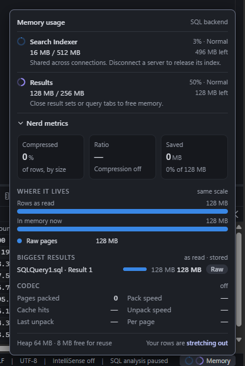

# Status bar memory meters

The Memory control sits at the bottom right of the status bar. Its blue ring shows the Search Indexer’s budget usage and its violet ring shows Results budget usage.

Hover or keyboard focus previews the breakdown above the status bar. Click, tap, Enter, or Space keeps it open. Escape or a click outside closes it. Each row shows memory used, the feature’s budget, the percentage used, the remaining memory, and what happens as the budget fills.

| Feature | Yellow | Red |
| --- | ---: | ---: |
| Search Indexer | 75% | 95% |
| Results | 90% | 95% |

## Nerd metrics

Below the two rows, **Nerd metrics** opens a closer look at what results hold, for the curious. It starts collapsed; its heading (a button: click, Enter or Space) opens and closes it, and Varia remembers the choice (`environment.statusBar.memoryNerdMetrics`, not shown in Options).

- **Tiles:** the share of rows compressed, by size; the compression ratio with the codec and its level; and the bytes compression saved, as a share of the rows as read.
- **Where it lives:** two bars on one scale, the rows as read above and the memory holding them below, split into raw pages, packed pages, the cache of unpacked pages, and a hatched part for what compression gave back. Each bar has a text equivalent.
- **Biggest results:** the eight largest results, named by their query tab and Results caption ("Query 3 · Result 1"; a live view's table, or a result no tab shows, is named as such), with their size as read, their stored size and their state (Raw, Packed, or Unpacking with its progress).
- **Codec:** pages packed, cache hit rate, the last unpack's time, pack and unpack speeds and the time per page, since the SQL backend started.
- **Footer:** the managed heap and the part of it free for reuse, which is why the operating system's figure for the backend can stay above what results hold, and a light line on how cozy your rows are.

Result compression is not on yet, so the panel says so plainly: stored sizes equal the rows as read, every result is Raw, the ratio and the codec's timings show a dash, and the Results row has no packed chip. Once pages are compressed, the Results ring gains a faint second arc for the rows' size as read, and a chip under the row says how much compression gave back ("−2,100 MB packed") and how many bytes of rows that memory holds. The Results row's figures stay the budget's: what the budget is charged.

The control takes the more severe of the two levels and adds a warning symbol. The breakdown names each level so the colors have a text equivalent. The Search Indexer’s yellow threshold reflects the 128 MiB that definitions leave available for object names in the 512 MiB budget.

## Data and implementation

- **Search Indexer.** The backend samples the estimated bytes charged for object records, names, and definitions across connections. It also reports usage after a server disconnects and releases its index.
- **Results.** The ring shows the result store’s runtime budget, which is a quarter of the computer's memory between 256 MiB and 16 GiB, or the limit set in Tools › Options, and includes live tables that draw from that store. Results memory updates come from global events and query summaries. A change to the limit applies to the running backend at once, and its `results.memory` event carries the new budget, so the ring and breakdown follow it without a restart. A limit lowered below what results hold shows above 100 % (red) until results are closed.
- **Nerd metrics.** Each `results.memory` event carries what the store holds (its `detail`: [Memory events](ipc.md#global-memory-events)), read only when the event goes out: no polling or timers in the renderer, and the section's figures change when results memory does. The section reads the Results tabs to name results only while it is open.
- **Lifecycle.** Both rings show unavailable until the backend reports a sample. A backend restart clears the old generation’s samples. [Memory events](ipc.md#global-memory-events)
