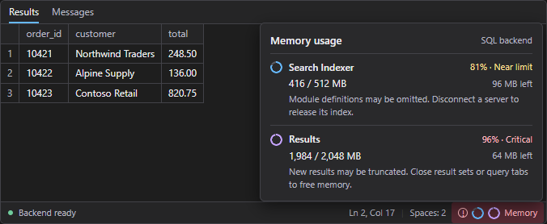

# Status bar memory meters

The Memory control sits at the bottom right of the status bar. Its blue ring shows the Search Indexer’s budget usage and its violet ring shows Results budget usage.

Hover or keyboard focus previews the breakdown above the status bar. Click, tap, Enter, or Space keeps it open. Escape or a click outside closes it. Each row shows memory used, the feature’s budget, the percentage used, the remaining memory, and what happens as the budget fills.

| Feature | Yellow | Red |
| --- | ---: | ---: |
| Search Indexer | 75% | 95% |
| Results | 90% | 95% |

The control takes the more severe of the two levels and adds a warning symbol. The breakdown names each level so the colors have a text equivalent. The Search Indexer’s yellow threshold reflects the 128 MiB that definitions leave available for object names in the 512 MiB budget.

## Data and implementation

- **Search Indexer.** The backend samples the estimated bytes charged for object records, names, and definitions across connections. It also reports usage after a server disconnects and releases its index.
- **Results.** The ring shows the result store’s runtime budget, which ranges from 256 MiB to 2 GiB, and includes live tables that draw from that store. Results memory updates come from global events and query summaries.
- **Lifecycle.** Both rings show unavailable until the backend reports a sample. A backend restart clears the old generation’s samples. [Memory events](ipc.md#global-memory-events)
